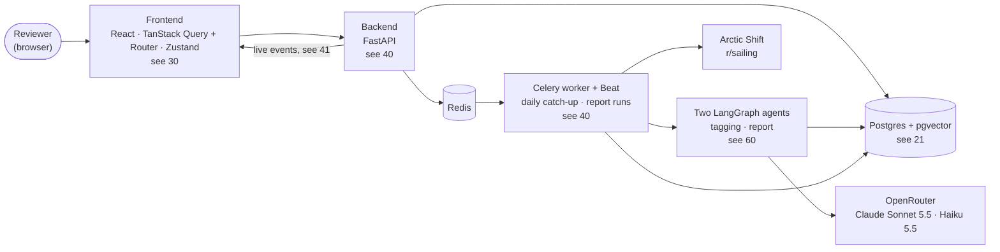

# 01 — System Map (DRAFT)

[← Index](00-index.md) · [Open questions](90-open-questions.md)

The whole Community Voices app at the highest level. Every box here is specified by
Brian; the details behind each are on its own plate.

- **Frontend** — specified. Details on [30 Frontend](30-frontend.md).
- **Backend** — FastAPI, specified. Its modules are on [40 Backend](40-backend.md).
- **Store** — Postgres with pgvector, specified. Tables on [21](20-data-model/21-topics.md).
- **Worker** — Celery with Beat, specified; one catch-up operation over a range of days ([40](40-backend.md)).
- **Agents** — two LangGraph agents, specified ([60](60-agents.md)), on Claude through OpenRouter: the report on Sonnet 5.5, tagging on Haiku 5.5.
- **Live events** — detailed server-sent events to the frontend, specified ([41](40-backend/41-live-events.md)).
- **Ingestion** — fetches posts daily, specified; from r/sailing (OPEN-3, resolved); fetched from the Arctic Shift archive (OPEN-8, resolved).
- Everything runs under Docker Compose, with every data store on a mounted volume —
  see [04 Environment](04-environment.md).

## Open in this draft

- Nothing open on this plate.
