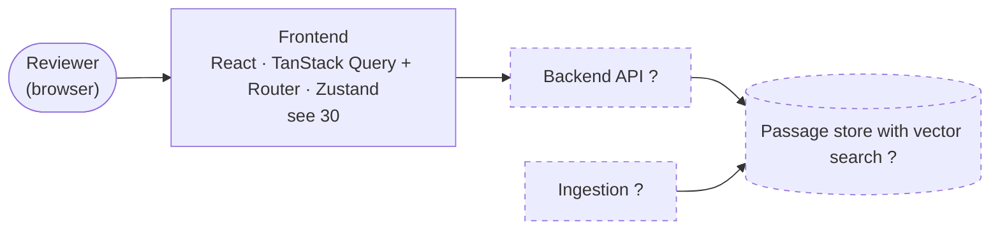

# 01 — System Map (DRAFT)

[← Index](00-index.md) · [Open questions](90-open-questions.md)

The whole Community Voices app at the highest level. So far only the frontend has
been specified; the other boxes are placeholders for parts the brief requires and
are drawn dashed until they're discussed.

- **Frontend** — specified. Details on [30 Frontend](30-frontend.md).
- **Backend API, passage store, ingestion** — `?` placeholders, not yet discussed.
  They're on the map only because the brief requires them (`README.md` → *Primary
  objective*).
- Everything runs under Docker Compose (the README's install steps already assume
  Docker).

## Open in this draft

- `?` Backend API, passage store and ingestion: not yet specified.
