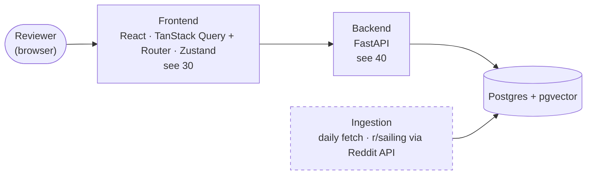

# 01 — System Map (DRAFT)

[← Index](00-index.md) · [Open questions](90-open-questions.md)

The whole Community Voices app at the highest level. The frontend and the backend
framework are specified; the other boxes are placeholders for parts the brief
requires and are drawn dashed until they're decided.

- **Frontend** — specified. Details on [30 Frontend](30-frontend.md).
- **Backend** — FastAPI, specified. Its modules are on [40 Backend](40-backend.md).
- **Passage store** — Postgres with pgvector, specified.
- **Ingestion** — fetches posts daily, specified; from r/sailing through Reddit's API (OPEN-3, resolved).
- Everything runs under Docker Compose (the README's install steps already assume
  Docker).

## Open in this draft

