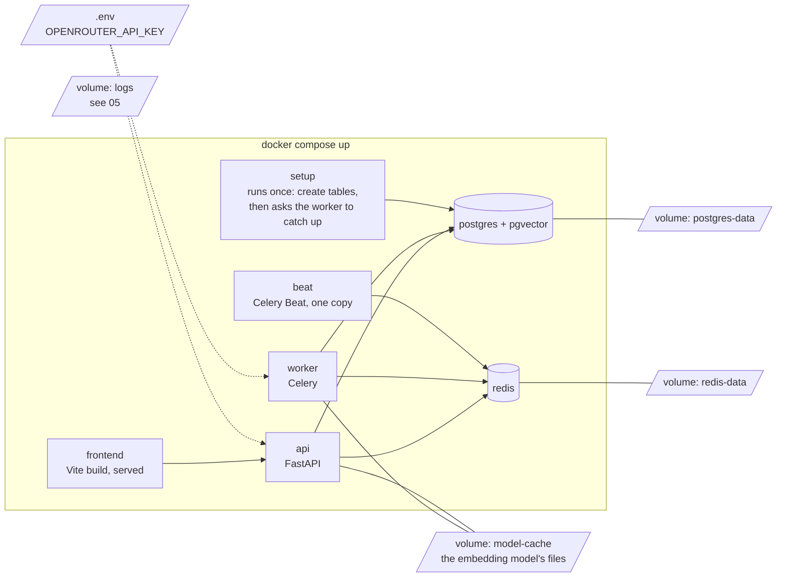

# 04 — Environment (DRAFT)

[← Index](00-index.md) · [01 System Map](01-system-map.md) · [40 Backend](40-backend.md) · [Open questions](90-open-questions.md)

How the app runs on a reviewer's machine. **Specified by Brian:** everything runs under
**Docker Compose**, and **every service that stores information keeps it on a mounted
volume**. The model key is an **OpenRouter** key, sent to the reviewers in the
submission email (README → *Install and run*). Everything else is *proposed*.

- **Mounted volumes** (specified): the database, Redis, and the embedding model's
  downloaded files each live on a volume, so stopping and restarting keeps everything
  and the model isn't downloaded twice. Redis is set to write to disk (append-only
  file) so queued jobs survive a restart *(proposed)*.
- **First start prewarms from live data** (specified for now, OPEN-13): no snapshot is
  committed. On first `docker compose up`, `setup` creates the tables and triggers the
  same catch-up the daily pull uses ([40](40-backend.md)): with an empty database, the
  missing range is the full eight weeks, processed day by day in order. There is no
  separate prewarm code. The reviewer waits it out. *Proposed:*
  the frontend opens at once and shows prewarm progress ("Day 23 of 56 · 9,412
  posts · tagging…") instead of a blank page, and the README says roughly how long it
  takes. A second start finds the data and skips it. How long it takes is to be
  measured once it's built.
- **One key, one file:** `.env.example` lists every setting with an explanation;
  only `OPENROUTER_API_KEY` must be filled in. Prewarm needs it, because tagging calls
  the model.
- **Ports:** the frontend on `http://localhost:5173` *(proposed)*. The browser also
  has to reach the API and its event streams; the frontend's server passes `/api`
  requests through to the API container, so only one port is exposed *(proposed)*.
- **First start also downloads the embedding model** (a few hundred megabytes) onto
  its volume — another wait, and another outside service (Hugging Face) the first
  start depends on.

## Open in this draft

- `?` How long prewarm takes, and whether that's acceptable for the demo — OPEN-13.
