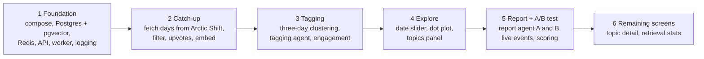

# 06 — Build order

[← Index](00-index.md) · [01 System Map](01-system-map.md) · [Open questions](90-open-questions.md)

The order the app gets built in. Brian agreed this order on 2026-10-18. **Each step ends
with something that runs from a fresh clone by following the README**, so there is
always a working version to submit while the next step is built.

| Step | Built | Runs at the end of it | Plates |
|---|---|---|---|
| 1 Foundation | Docker Compose with every service and its volumes, tables, the API's health route, the worker and Beat, the logging module, `.env.example` | `docker compose up` starts everything; the README's steps work | [04](04-environment.md), [05](05-logging.md) |
| 2 Catch-up | The day job and the catch-up chain: fetch, drop deleted and bot posts, fold agreeing replies into upvotes, embed; `ingested_days`; progress events | First start fills eight weeks of posts with embeddings, and shows progress | [40](40-backend.md), [21](20-data-model/21-topics.md), [41](40-backend/41-live-events.md) |
| 3 Tagging | Three-day clustering, the tagging agent with its tools, noise deletion, daily engagement | Every post is tagged or deleted; each tag has a daily engagement history | [21](20-data-model/21-topics.md), [60](60-agents.md) |
| 4 Explore | The frontend: date slider, dot plot recomputed per range, topics panel | A reviewer can explore the community visually | [30](30-frontend.md), [31](30-frontend/31-screens.md) |
| 5 Report + A/B test | The report agent with and without retrieval, trend extrapolation, the answer key and scoring, live events to the progress panel, the report and comparison screens | The brief is fully met: Generate report produces both versions, scored | [50](50-prediction.md), [60](60-agents.md), [70](70-comparison.md) |
| 6 Remaining screens | Topic detail with its engagement chart; retrieval statistics | Everything on the screens plate exists | [31](30-frontend/31-screens.md) |

Every step is test-first (`/tdd`), and every commit goes through the commit chain
(`CLAUDE.md` §6). `/test-boot` runs at the end of each step.
