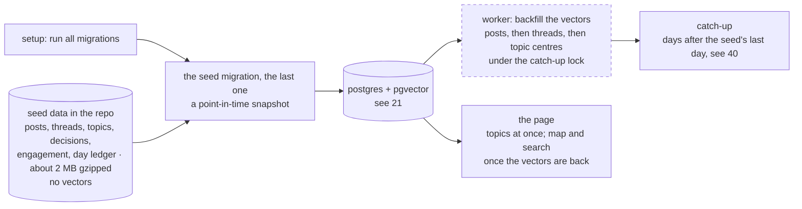

# 07 — Boot data migration (DRAFT)

[← Index](00-index.md) · [01 System Map](01-system-map.md) · [04 Environment](04-environment.md) · [21 Topics](20-data-model/21-topics.md) · [40 Backend](40-backend.md) · [Open questions](90-open-questions.md)

How a reviewer's database is seeded on first boot, quickly and without a large download.
Today a first start fetches eight weeks from the archive and tags them with the model:
about 1 hour 40 minutes and $1.30 to $1.70 (OPEN-13). This plate replaces that with data
that comes with the repo.

**Specified by Brian (2026-10-19):**
- The seeded data comes over **with the repo, encoded in a migration**: the posts and
  their metadata, including the topics, and everything else the app has worked out.
- **The vectors are not encoded.** The boot's last step runs all migrations and then
  **backfills every vector that didn't come over**.
- The purpose: a quick and easy seed that doesn't hit the reviewer with 80 MB, or even
  10 MB, of data, zipped databases and the like.
- **The migration is written as the last build step**, on whatever schema the app has then
  (OPEN-35): a **point-in-time snapshot**. If the schema changes later, a migration changes
  it, seeded rows included.
- **Loading progress is first class in the app** (Brian, 2026-10-19): the top bar shows the backfill counting up live ("Preparing the history: 4,120 of 12,682 posts"), then the catch-up's days, as one progress line for the whole first boot. The backfill reports on the same live `ingestion` stream as the catch-up (`backfill.progress` events, plate 41), and the API's loading status includes it, so a page opened mid-way shows where it is.
- **The app stays live after the seed** (OPEN-36): the catch-up fetches and tags the days
  since the seed's last day. A few days of that on the reviewer's machine is fine, even good;
  the seed only spares a cold boot from processing the whole history.

Everything else on this plate is *proposed*, from a red-team of the plan against the code.

The seed migration holds the rows and runs with the others; the worker then rebuilds the
vectors before it does anything else, and catches up the days since the seed. The database is plate
[21](20-data-model/21-topics.md); the catch-up is plate [40](40-backend.md).

## What comes over, and how big it is

Measured on the local database (12,682 posts and comments, 640 threads, 152 topics),
as CSV and gzipped:

| Rows | Raw | Gzipped | Comes over |
|---|---|---|---|
| Posts and comments (text, author, time, scores, upvotes, parent) | 3.7 MB | 1.5 MB | yes |
| Threads (title, start, first seen, topic, stage) | 67 KB | 27 KB | yes |
| Topics (label, description, keywords, first and last seen) | 62 KB | 24 KB | yes |
| Tagging decisions, without their prompts | 3.4 MB | 344 KB | yes |
| The exact prompt behind each decision | 5.3 MB | 571 KB | no *(proposed)*: the bulk, and only for tracing |
| Daily engagement, daily upvotes, the day ledger | 53 KB | 9 KB | yes |
| Retrieval records (all from tagging) | 528 KB | 47 KB | yes, so the most-retrieved list isn't empty |
| **Total** | | **about 2 MB** | |

The vectors, left behind, are most of the database: 37 MB of the 75 MB at full
precision.

## The backfill *(proposed)*

- **Posts and comments** are embedded again by the same model, each whole, as at intake.
- **Threads** are encoded again as their *final* text: the post (or its title, if the post
  isn't stored) and its top five replies as they stood at the end of the thread's third
  day, or its first day for a thread still waiting for its third. This reuses the tagging
  code's own reads and `thread_text`, not a copy of them.
- **Topic centres** are then the average of their threads' new embeddings, which is what
  they are now (checked: every topic's centre matches that average to within 0.001). The
  2 topics left with no threads are not seeded.
- Re-embedding won't give the stored numbers bit for bit (batching and the processor change
  the last digits), but the nearest neighbours, the grouping and the map hold. A test
  checks a sample against today's vectors (similarity 0.999 or more).
- **It resumes.** It works in batches, each committed, picking up whatever still has no
  vector, so a restart mid-way carries on. It runs inside the catch-up lock, before the
  catch-up, so tagging never sees a store without vectors.
- **How long.** Measured on an M4 Max (Docker with 14 cores): 30 to 60 posts a second, so
  about 4 to 7 minutes for the posts and 1 to 3 more for the thread texts. A base M1 to M3
  is slower: about **10 to 15 minutes** in all *(estimate from a 4-thread run)*. Limiting the
  model to 4 threads ran faster than its default (60 against 30 posts a second), so the
  backfill sets its thread count.
- **While it runs**, the topics, the slider and the badges work at once (they need no
  vectors). The map and search wait, and no map drawn before the backfill finishes is kept;
  the progress line (specified, above) says how far it has got.

## The seed migration *(details proposed)*

- **One migration, written last** (specified, OPEN-35). It reads a gzipped data file kept
  beside it, with the table and column names written out in the migration itself rather
  than taken from the table models, so it stays exactly the snapshot it was when the
  models change later. Alembic runs it once, in order, like every migration.
- Rows keep their ids, and every id counter is moved past them, so the next new topic or
  decision doesn't collide with a seeded one.
- **After it, the app is live** (specified, OPEN-36): the catch-up takes the days from the
  seed's last day to yesterday, fetching and tagging each, once the backfill is done.

## Open in this draft

- `?` Reddit content and usernames in a public repo (OPEN-37), Brian thinking it over.
