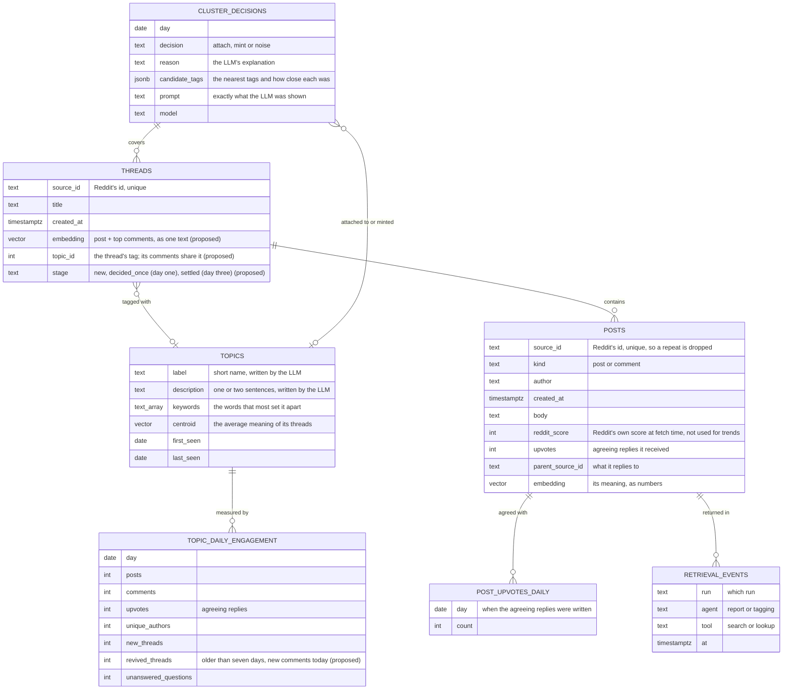
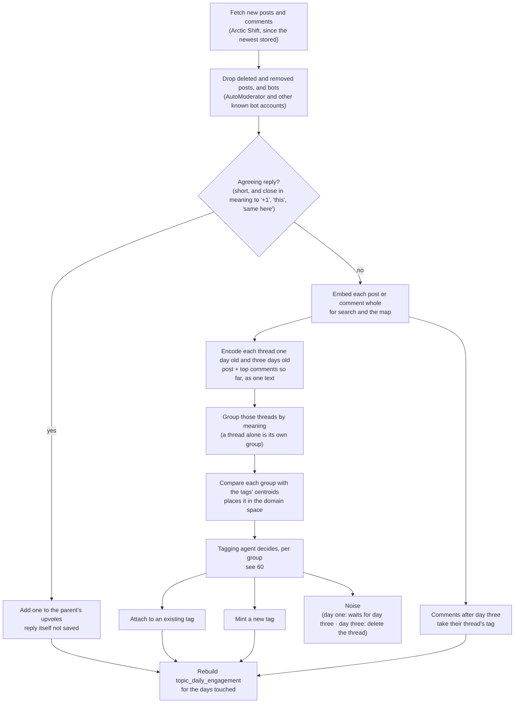

# 21 — Topics and engagement over time (DRAFT)

[← Index](../00-index.md) · [01 System Map](../01-system-map.md) · [40 Backend](../40-backend.md) · [50 Prediction](../50-prediction.md) · [60 Agents](../60-agents.md) · [Open questions](../90-open-questions.md)

How the community's conversation is stored as **topics** that can be followed day by
day. This is what the prediction stands on: next week is forecast from how each
topic's engagement has been moving, not guessed from one week of text.

**Specified by Brian:**
- Postgres holds a table of topic tags. Each tag carries semantic information, and its
  engagement over time is easy to graph.
- Posts are fetched daily and **tagged by day on intake**. Any time range (a week, the
  eight weeks of history) is then just a range of days (OPEN-10).
- Each day, embeddings are clustered with a **three-day lookahead**: a post has three
  days to fall into a cluster. Each cluster is compared with the tags' embeddings to
  place it in the domain space, and an LLM makes the final call per cluster: **add it
  to an existing tag, mint a new tag, or ignore it as noise**. A post that hasn't
  fallen into a cluster within three days **is noise and is deleted**.
- **Posts are not cut into pieces**: one post or comment is one embedding.
- Comments are semantically tied to their post, so it makes sense to **encode the whole
  thread as one unit**. Comments arriving later are **a heat signal**, and an old thread
  that **suddenly becomes active again** is another heat signal (2026-10-18; when the
  thread is encoded, and whether it's re-encoded, is OPEN-29).
- **A thread is encoded on day one, then encoded again on day three** (OPEN-29,
  2026-10-18). Day one avoids a three-day lag before a topic shows; day three uses the
  comments that have arrived since. This replaces the three-day lookahead above: a
  thread gets its decision on day one and its second decision on day three.
- Deleted posts and bot posts are dropped. **Short agreeing replies** ("+1", "this",
  "same here") are significant and inform the trend, but aren't saved as posts. A basic
  semantic check finds them, and each one adds to an **`upvotes`** count on the post it
  replies to, a magnitude increaser for that post (OPEN-19).

**Everything else on this plate is *proposed*.**

## Tables

### What each table is for

- **threads, posts** — the community's posts and comments as fetched, one embedding
  each. Reddit's id is unique, so the small overlap between daily pulls is dropped on
  insert (`CLAUDE.md` §7). A post has no tag of its own: it counts for its
  thread's, so a comment arriving later counts too. Noise is deleted rather than marked.
- **upvotes** — Brian's design: an agreeing reply isn't stored; it adds one to its
  parent's `upvotes`. *Proposed:* the count is also kept per day in
  **post_upvotes_daily** (post, day, count, with no text), because the trend needs to
  know *when* the agreement happened: "+1"s arriving on Friday for a Monday post are
  Friday's engagement. The name `upvotes` is ours; Reddit's own score is kept apart as
  `reddit_score` so the two are never confused. Upvotes ride on their parent: they count
  toward its tag, and go if it's deleted as noise.
- **topics** — the topic tags. The *semantic information* is four things together:
  - a **label** and **description** a person can read, written by the LLM from the
    tag's most typical posts;
  - **keywords**, the words that most set it apart from other tags, computed by code;
  - the **centroid**: the average of its posts' embeddings, the tag's position in
    meaning-space. Clusters are compared against the centroids to find the tags they
    might belong to, and the centroid moves whenever posts are added.
- **topic_daily_engagement** — one row per tag per day: posts, comments, upvotes,
  distinct people, new threads, revived threads *(proposed)* and unanswered questions. **This is the graph.** Any
  range — a week, eight weeks — is a sum over its days. Rebuilt from the posts after
  each day's intake, never edited by hand. Eight weeks of about thirty tags is under two
  thousand rows.
- **retrieval_events** — one row each time a post is returned by the agents' search or
  lookup tools ([60](../60-agents.md)): which run, which agent, which tool, when
  (OPEN-12, resolved). The retrieval-statistics screen counts these; the report
  agent's retrievals are shown apart from the tagging agent's.
- **cluster_decisions** — one row per group of threads per day: what the LLM decided, why, which
  tags it was choosing between and how close each was, and the exact prompt it saw.
  Every tag is traceable to the decisions that built it, and because tagging always
  moves forward one day at a time, it also records what was known on each day — which
  is what keeps the backtest honest (OPEN-11).

## The daily intake

Runs once a day as a Celery job ([40](../40-backend.md)). The flow is specified by
Brian; details in brackets are *proposed*.

- **Why the whole thread is the unit:** most comments ("Awesome, thanks!") carry no
  subject of their own; their thread does. Grouping single posts left 86% in no group.
  A thread written out as its post plus its top five comments grouped into the most
  coherent subjects of everything measured (OPEN-29).
- **Why day one and day three:** encoding on day one means a topic shows the day after
  its first post, not three days later, so the freshest days of a report aren't
  missing. Encoding again on day three uses the replies that have come in since. *(Proposed:)*
  the day-three decision is final; if it moves a thread to a different tag, only that
  thread's first three days of engagement move with it.
- **Heat after day three:** comments arriving later take their thread's tag and count
  as engagement on the day they're written. *(Proposed:)* each day also counts, per
  tag, the **revived threads**: threads more than seven days old that got new comments
  that day.
- *(Proposed:)* grouping is by closeness of meaning with a fixed cutoff (cosine
  distance 0.3 measured well), so every thread gets a decision, even one on its own.
- **Why the LLM decides rather than a threshold:** closeness in meaning-space alone
  can't tell "the same conversation continuing" from "a new conversation next door to
  an old one". The LLM reads the posts and the candidate tags' descriptions.
- **Tagging always moves forward in time**, one day after another. After a thread's
  day-three decision nothing about it is re-decided, so a tag's history older than
  three days never changes under it.
- **Cost:** one LLM call per group, twice per thread. Measured groups suggest roughly
  twenty a day each time, so about forty calls a day and around two thousand for the
  eight-week history *(estimate, not yet measured)*. On Claude Haiku 5.5 with at most
  three look-ups (Brian, 2026-10-18), that is about a fifth of a cent a call, so under
  $5 for the eight weeks *(estimate, not yet measured)*. The bake-off measured about
  $0.0005 a decision on Haiku (plate [60](../60-agents.md)), so roughly $1 for the eight
  weeks *(measured on 25 sample decisions, not yet on real days)*.
- **Tests** replace the LLM and the embedder with stand-ins (`CLAUDE.md` §7).

## Where similarity search is used

Comparing a cluster with the tags, and the agents' search tool ([60](../60-agents.md)),
are both "find the closest vectors" questions, which pgvector answers inside Postgres
(OPEN-4, resolved).

## Open in this draft

- `?` The word limit and closeness threshold for an agreeing reply — tuned against
  the real data.
- `?` What happens to a reply whose parent was deleted as noise *(proposed: the parent
  keeps a stub row — id, author, time, no text or embedding — so threads stay connected
  and lookup can say "removed as noise")*.
- `?` The grouping cutoff, and how many nearest tags the LLM is shown — tuned against
  the real data.
- `?` Whether tags that go quiet are ever merged or retired.
- `?` How to tag a thread whose opening post we don't have: removed, or older than our history (OPEN-30).
