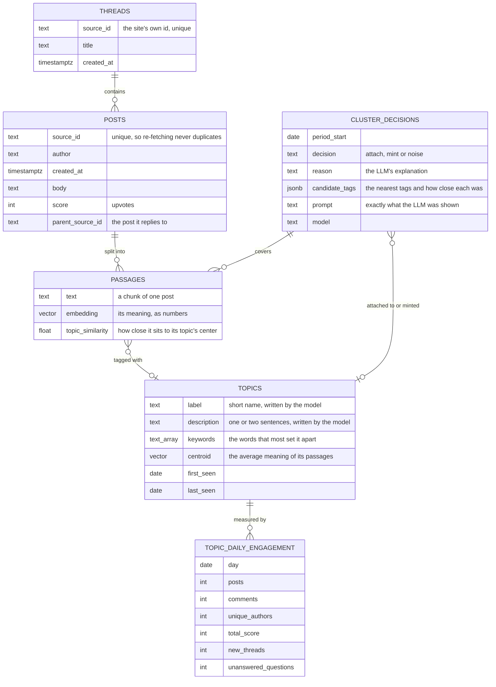
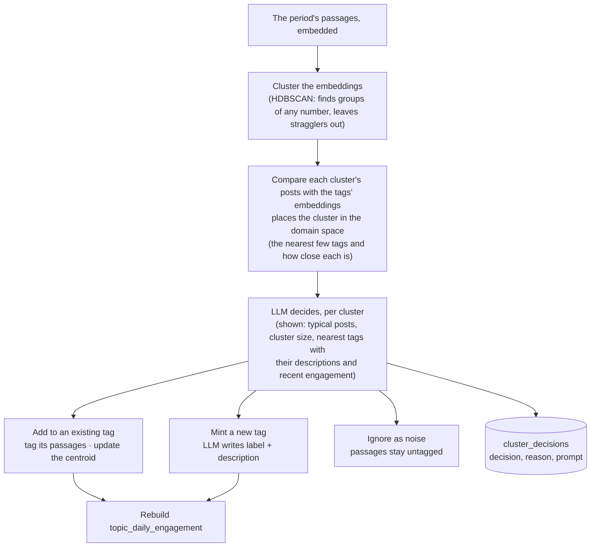

# 21 — Topics and engagement over time (DRAFT)

[← Index](../00-index.md) · [01 System Map](../01-system-map.md) · [40 Backend](../40-backend.md) · [Open questions](../90-open-questions.md)

How the community's conversation is stored as **topics** that can be followed week to
week. This is what the prediction stands on: next week is forecast from how each
topic's engagement has been moving, not guessed from one week of text.

**Specified by Brian:** Postgres holds a table of topic tags. Each topic carries
semantic information, and its engagement over time is easy to graph. Prediction is
made from measured signals rather than by asking the model to guess. Posts are fetched
**daily**. Clustering runs **on demand, over whatever time period is requested**
(OPEN-6, resolved): that period's embeddings are clustered, each cluster's posts are compared with the topic tags' embeddings to
place the cluster in the domain space, and an LLM, given all of that, makes the final
call for each cluster: **add it to an existing tag, mint a new tag, or ignore it as
noise** (see *How topics stay the same topic*).
**Everything else on this plate is *proposed*** — the table layout below is the
answer to "how should that be structured".

## Tables

### What each table is for

- **threads, posts** — the raw community data, exactly as fetched. The site's own id is
  unique, so fetching the same week twice changes nothing (`CLAUDE.md` §7).
- **passages** — each post cut into pieces small enough to embed and to hand the
  model. Each passage has its embedding and **at most one topic**: the topic its
  cluster was attached to, or none if its cluster was judged noise. One topic at most
  keeps the counts honest: a passage is never counted twice.
- **topics** — the topic tags. The *semantic information* is four things together:
  - a **label** and **description** a person can read, written by the model from the
    topic's most typical passages;
  - **keywords**, the words that most distinguish it from other topics, computed by
    code;
  - the **centroid**: the average of its passages' embeddings, which is the topic's
    position in meaning-space. A new cluster is compared against the centroids to
    find the tags it might belong to, and the centroid is updated whenever a cluster
    is added.
- **topic_daily_engagement** — one row per topic per day: how many posts, comments,
  distinct people, upvotes, new threads and unanswered questions. **This is the
  graph.** Engagement over time for any topic is one query, and weekly totals are sums
  of seven rows. It's a summary rebuilt from the posts after each ingestion, never
  edited by hand, so it can always be recreated from the raw data. Five weeks of about
  thirty topics is roughly a thousand rows.
- **cluster_decisions** — one row per cluster per period: what the LLM decided, why,
  which tags it was choosing between and how close each was, and the exact prompt it
  saw. *(proposed)* It makes every tag traceable to the decisions that built it,
  and it means a period that has already been processed is never re-decided, so
  re-running ingestion gives the same tags.

## How topics stay the same topic from week to week

Grouping posts from scratch every period would invent fresh groups each time, with no
link to the last period's. So clusters are matched to the existing tags, and an LLM
makes the final call. **This flow is specified by Brian;** the details in brackets are
*proposed*.

- **Why the LLM decides rather than a threshold:** closeness in meaning-space alone
  can't tell "the same conversation continuing" from "a new conversation next door to
  an old one" or from chatter. The LLM reads the posts and the candidate tags'
  descriptions, which the numbers can't do.
- **Its answer is structured:** one of attach (naming the tag), mint (with a label and
  description) or noise, plus a one-sentence reason. *(proposed)*
- **Cost:** one LLM call per cluster per period; a week of a busy subreddit is a few
  dozen clusters. *(proposed estimate)*
- **Tests** replace the LLM with a stand-in that returns fixed decisions
  (`CLAUDE.md` §7). *(proposed)*

A topic that keeps being discussed keeps its identity and its history, and a newly
minted tag carries a `first_seen` date, which is itself a prediction signal ("this
started three days ago and is growing fast").

## Where similarity search is used

Comparing a cluster with the tags and the passage retrieval for the document are both "find
the closest vectors" questions, which is what the pgvector extension does inside
Postgres. **pgvector is decided** (OPEN-4, resolved) for both jobs.

## Open in this draft

- `?` When a requested period overlaps one already clustered, which passages are
  clustered again. Proposed: only passages not yet decided; passages already tagged
  keep their tag, so a tag's history never changes under it.
- `?` The smallest group the clustering counts as a cluster, and how many nearest tags
  the LLM is shown — to be tuned against the real snapshot.
- `?` How a passage is cut from a post (length, overlap) — a later plate on ingestion.
- `?` Whether topics that go quiet are ever merged or retired.
