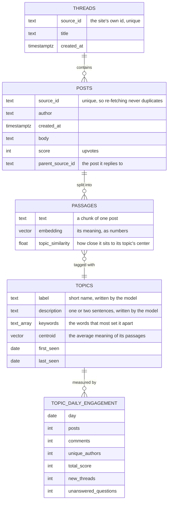
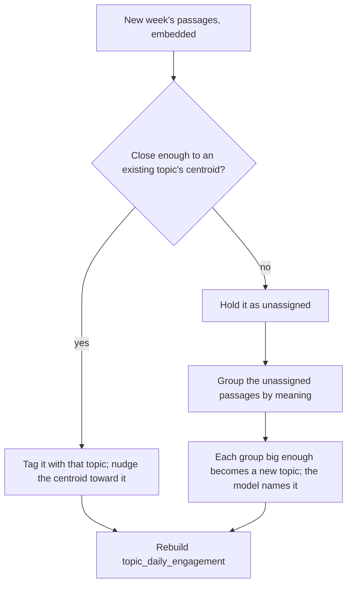

# 21 — Topics and engagement over time (DRAFT)

[← Index](../00-index.md) · [01 System Map](../01-system-map.md) · [40 Backend](../40-backend.md) · [Open questions](../90-open-questions.md)

How the community's conversation is stored as **topics** that can be followed week to
week. This is what the prediction stands on: next week is forecast from how each
topic's engagement has been moving, not guessed from one week of text.

**Specified by Brian:** Postgres holds a table of topic tags. Each topic carries
semantic information, and its engagement over time is easy to graph. Prediction is
made from measured signals rather than by asking the model to guess.
**Everything else on this plate is *proposed*** — the table layout below is the
answer to "how should that be structured".

## Tables

### What each table is for

- **threads, posts** — the raw community data, exactly as fetched. The site's own id is
  unique, so fetching the same week twice changes nothing (`CLAUDE.md` §7).
- **passages** — each post cut into pieces small enough to embed and to hand the
  model. Each passage has its embedding and **one topic**. One topic per passage keeps
  the counts honest: a passage is never counted twice.
- **topics** — the topic tags. The *semantic information* is four things together:
  - a **label** and **description** a person can read, written by the model from the
    topic's most typical passages;
  - **keywords**, the words that most distinguish it from other topics, computed by
    code;
  - the **centroid**: the average of its passages' embeddings, which is the topic's
    position in meaning-space. New passages are tagged by finding the nearest
    centroid, and it's what lets a topic be recognized again next week.
- **topic_daily_engagement** — one row per topic per day: how many posts, comments,
  distinct people, upvotes, new threads and unanswered questions. **This is the
  graph.** Engagement over time for any topic is one query, and weekly totals are sums
  of seven rows. It's a summary rebuilt from the posts after each ingestion, never
  edited by hand, so it can always be recreated from the raw data. Five weeks of about
  thirty topics is roughly a thousand rows.

## How topics stay the same topic from week to week

This is the hard part, and why the centroid exists. Grouping posts by meaning from
scratch every week would invent fresh groups each time, with no link to last week's.
Instead, after each week is fetched:

So a topic that keeps getting talked about keeps its identity and its history, and a
genuinely new conversation shows up as a new topic with a `first_seen` date, which is
itself a prediction signal ("this started three days ago and is growing fast").

## Where similarity search is used

The nearest-centroid step and the passage retrieval for the document are both "find
the closest vectors" questions, which is what the pgvector extension does inside
Postgres. That's a second use beyond retrieval, so the recommendation in OPEN-4 now
covers both.

## Open in this draft

- `?` The closeness threshold for "same topic", and the smallest group that counts as a
  new topic — to be tuned against the real snapshot.
- `?` How a passage is cut from a post (length, overlap) — a later plate on ingestion.
- `?` Whether topics that go quiet are ever merged or retired.
