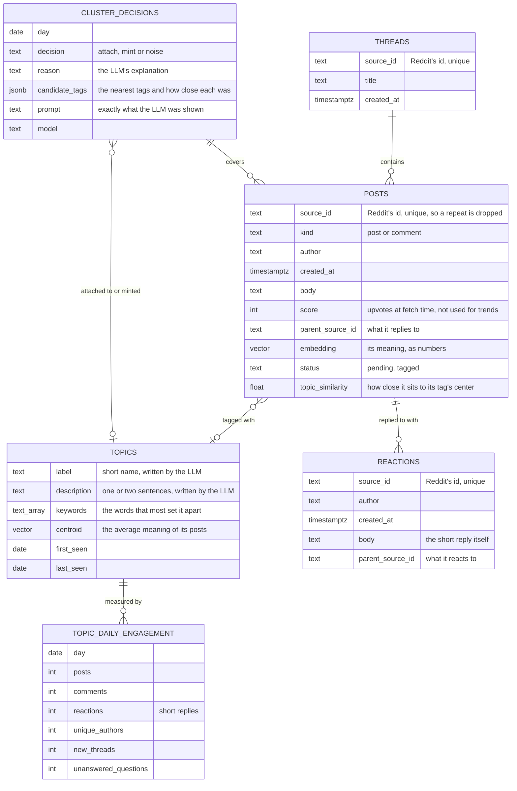
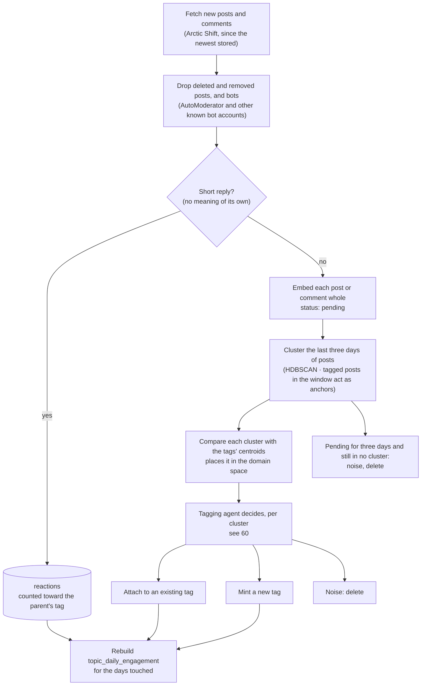

# 21 — Topics and engagement over time (DRAFT)

[← Index](../00-index.md) · [01 System Map](../01-system-map.md) · [40 Backend](../40-backend.md) · [50 Prediction](../50-prediction.md) · [60 Agents](../60-agents.md) · [Open questions](../90-open-questions.md)

How the community's conversation is stored as **topics** that can be followed day by
day. This is what the prediction stands on: next week is forecast from how each
topic's engagement has been moving, not guessed from one week of text.

**Specified by Brian:**
- Postgres holds a table of topic tags. Each tag carries semantic information, and its
  engagement over time is easy to graph.
- Posts are fetched daily and **tagged by day on intake**. Any time range (a week, the
  eight weeks of history) is then just a range of days (OPEN-10).
- Each day, embeddings are clustered with a **three-day lookahead**: a post has three
  days to fall into a cluster. Each cluster is compared with the tags' embeddings to
  place it in the domain space, and an LLM makes the final call per cluster: **add it
  to an existing tag, mint a new tag, or ignore it as noise**. A post that hasn't
  fallen into a cluster within three days **is noise and is deleted**.
- **Posts are not cut into pieces**: one post or comment is one embedding.
- Deleted posts and bot posts are dropped. **Short replies are kept**: they're
  significant, and they are tabulated, because they inform the trend.

**Everything else on this plate is *proposed*.**

## Tables

### What each table is for

- **threads, posts** — the community's posts and comments as fetched, one embedding
  each. Reddit's id is unique, so the small overlap between daily pulls is dropped on
  insert (`CLAUDE.md` §7). A post is `pending` until a cluster takes it, then `tagged`;
  noise is deleted rather than marked.
- **reactions** — short replies ("this", "+1", "same here") *(proposed, OPEN-19)*. They
  carry no meaning of their own to cluster, so they are not embedded; they count toward
  the tag of the post they reply to, on the day they were written. Kept in their own
  table so the three-day noise rule can't delete them for failing to cluster.
- **topics** — the topic tags. The *semantic information* is four things together:
  - a **label** and **description** a person can read, written by the LLM from the
    tag's most typical posts;
  - **keywords**, the words that most set it apart from other tags, computed by code;
  - the **centroid**: the average of its posts' embeddings, the tag's position in
    meaning-space. Clusters are compared against the centroids to find the tags they
    might belong to, and the centroid moves whenever posts are added.
- **topic_daily_engagement** — one row per tag per day: posts, comments, reactions,
  distinct people, new threads and unanswered questions. **This is the graph.** Any
  range — a week, eight weeks — is a sum over its days. Rebuilt from the posts after
  each day's intake, never edited by hand. Eight weeks of about thirty tags is under two
  thousand rows.
- **cluster_decisions** — one row per cluster per day: what the LLM decided, why, which
  tags it was choosing between and how close each was, and the exact prompt it saw.
  Every tag is traceable to the decisions that built it, and because tagging always
  moves forward one day at a time, it also records what was known on each day — which
  is what keeps the backtest honest (OPEN-11).

## The daily intake

Runs once a day as a Celery job ([40](../40-backend.md)). The flow is specified by
Brian; details in brackets are *proposed*.

- **Why three days:** one day of r/sailing is often too few posts for a conversation to
  form a cluster. Giving every post three days lets a thread that starts slowly gather
  enough company, while anything still alone after three days really is noise.
- **Why the LLM decides rather than a threshold:** closeness in meaning-space alone
  can't tell "the same conversation continuing" from "a new conversation next door to
  an old one". The LLM reads the posts and the candidate tags' descriptions.
- **Tagging always moves forward in time**, one day after another. Nothing tagged is
  re-decided, so a tag's history never changes under it.
- **Cost:** one LLM call per cluster per day, roughly ten a day for r/sailing. Tagging the
  eight-week history once is a few hundred calls *(estimate)*.
- **Tests** replace the LLM and the embedder with stand-ins (`CLAUDE.md` §7).

## Where similarity search is used

Comparing a cluster with the tags, and the agents' search tool ([60](../60-agents.md)),
are both "find the closest vectors" questions, which pgvector answers inside Postgres
(OPEN-4, resolved).

## Open in this draft

- `?` How a short reply is recognized — OPEN-19.
- `?` What happens to a reply whose parent was deleted as noise *(proposed: the parent
  keeps a stub row — id, author, time, no text or embedding — so threads stay connected
  and lookup can say "removed as noise")*.
- `?` The smallest group the clustering counts as a cluster, and how many nearest tags
  the LLM is shown — tuned against the real data.
- `?` Whether tags that go quiet are ever merged or retired.
