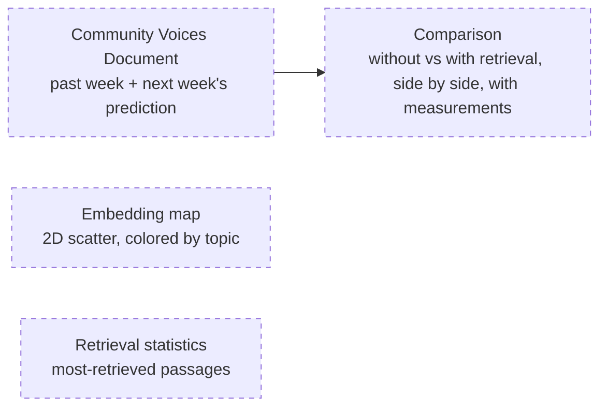

# 30 — Frontend (DRAFT)

[← Index](00-index.md) · [01 System Map](01-system-map.md) · [Open questions](90-open-questions.md)

The web app the reviewer clicks through. Brian specified React, TanStack Query,
TanStack Router and Zustand, and on 2026-10-18 agreed to the rest of the stack as
proposed. The screens below are still a proposal.

## Stack

| Concern | Choice |
|---|---|
| UI library | **React** — specified |
| Routing | **TanStack Router** — specified |
| Server state | **TanStack Query** — specified. Everything fetched from the backend lives here |
| Client state | **Zustand** — specified. Proposed rule: only for state that lives purely in the browser (for example which comparison panel is expanded). Anything a reviewer should be able to link to — the selected week, the selected run — lives in the address, through TanStack Router's search parameters |
| Language and build | TypeScript, built with Vite |
| Tables | TanStack Table, for the retrieval-statistics list and the comparison measurements |
| Embedding chart | Apache ECharts — draws a few thousand points in a 2D scatter on a canvas, with hover and coloring built in |
| Showing the document | The Community Voices Document rendered from markdown |
| Styling | Tailwind CSS |
| API client | Typed client generated from the backend's API description — the backend must publish an OpenAPI description (OPEN-1 resolved) |
| Tests | Vitest + React Testing Library, with a stand-in backend (MSW) so tests run offline (`CLAUDE.md` §7) |
| Lint and format | ESLint + Prettier, one of each (`CLAUDE.md` §8) |
| Running it | Its own service in Docker Compose |

## Screens the brief implies *(proposed)*

These four come from the brief's requirements (`README.md` → *Primary objective*),
not from Brian; the layout and navigation between them haven't been discussed.

## Open in this draft

- `?` The screens, their layout, and how a reviewer moves between them.
