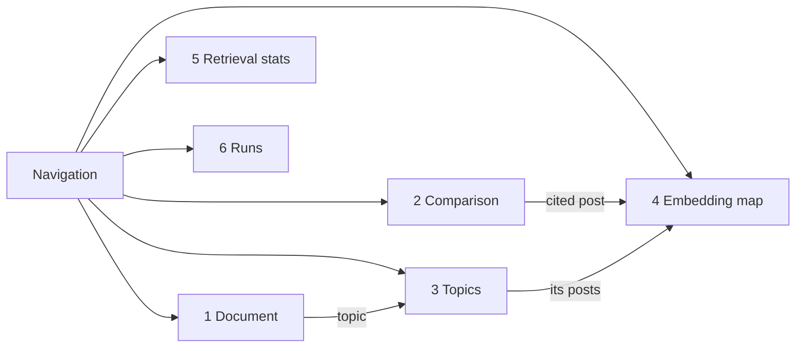

# 31 — Screens (DRAFT)

[← Index](../00-index.md) · [30 Frontend](../30-frontend.md) · [21 Topics](../20-data-model/21-topics.md) · [50 Prediction](../50-prediction.md) · [70 Comparison](../70-comparison.md) · [Open questions](../90-open-questions.md)

The app's screens, written as a design brief: the section below the line can be pasted
into Claude Design as-is to produce mockups. The document's content follows the brief
(OPEN-16, resolved); layout and styling are *proposed*. Sample content is illustrative,
not real data.

---

## Design brief for Claude Design

**Product.** *Community Voices* — a web app that writes a weekly report on what an
online community talked about and predicts what it will talk about next week. The
community is **r/sailing** on Reddit. The report is written by an AI agent that
searches a database of the community's posts. The app also shows the same report
written by the AI **without** access to that database, side by side, with
measurements — that comparison is the centerpiece.

**Audience.** An engineering team watching a live demo on a laptop screen. It must read
clearly at 1440×900 and still work at phone width.

**Style.** Calm, editorial, data-dense but uncluttered — a cross between a good
newsletter and an analytics dashboard. A restrained nautical palette: deep navy ink,
off-white paper, one teal accent for "with retrieval" (version B), one warm sand/amber
for "without retrieval" (version A), and a coral used only for warnings (unsupported
claims). Serif for the report's headings and body text; a clean sans-serif for UI,
numbers and labels. Light and dark themes. No stock photos, no sailing clip-art.

**Global layout.** A narrow left sidebar with the app name, a **week picker**
("Week of 5–11 Oct 2026", with previous/next arrows), and navigation: Document,
Comparison, Topics, Embedding map, Retrieval stats, Runs. Top-right: a theme toggle and
a small status pill showing data freshness ("Data through 17 Oct · 8 weeks · 21,480
posts").

### Screen 1 — Document

The Community Voices Document for the selected week, as a readable long page (max
width ~760px, centered).

- **Masthead:** "Community Voices — r/sailing", the week, and a subtitle line:
  "Written with retrieval · Claude · run #42 · Export as Markdown".
- **The week in brief:** one paragraph summary.
- **What the community talked about:** 5–7 topic sections. Each has:
  - the topic name and a one-line description;
  - a small engagement sparkline for the last 8 weeks with this week highlighted, and a
    badge: Rising / Steady / Fading / New;
  - two or three paragraphs of the report;
  - "Notable threads": 2–3 thread titles as links, each with comment count;
  - one or two pull-quotes from real posts, with username and date, e.g.
    *"Third time this season the impeller's gone. Carrying two spares now." — u/saltyketch,
    8 Oct*. Every quote and cited fact has a small superscript marker linking to the
    source post.
  - Example topics: "Winterizing and haul-out", "Impeller and raw-water cooling
    failures", "Hurricane season aftermath in the Caribbean", "First boat: what to buy
    under $20k", "Annapolis Sailboat Show", "Reefing technique in heavy weather".
- **What we expect next week:** 4–6 prediction cards. Each: topic name, badge, a small
  line chart of daily engagement for 8 weeks plus a dashed projection band for next
  week, and one sentence of evidence: *"Up from 3 to 11 threads over three weeks; two
  debates still open on Sunday."* A card for a scheduled event: *"Annapolis Sailboat
  Show opens Thursday — mentioned in 14 posts."*
- **Footer note:** "Brand-new conversations can't be predicted; this forecast covers
  topics already in motion."

### Screen 2 — Comparison (the centerpiece)

Version A (without retrieval) and version B (with retrieval) of the same week's
document, side by side.

- **Scoreboard strip** across the top, A vs B, each metric as two numbers with a small
  bar: Grounded claims (A 4 / B 37), Unsupported claims (A 19 / B 2), Topics covered
  (A 2 of 7 / B 6 of 7), Specific references (A 3 / B 58), Prediction score on held-back
  week (A 22% / B 71%), Tokens and time (A 2.1k · 9s / B 48k · 64s).
- **Two columns** of the document, A labeled "Without our data — the model on its own"
  in amber, B labeled "With retrieval — the model searching r/sailing's posts" in teal.
  Each claim is underlined: teal-solid for grounded (hover shows the source post
  excerpt), coral-dotted for unsupported (hover: "No matching post found this week").
  Version A should read plausible but generic ("Sailors discussed maintenance and
  safety as the season winds down").
- **Topic coverage grid** below: rows are the week's real topics ranked by engagement;
  two columns of check / cross for A and B.
- **"What version B looked at"** drawer: the agent's tool calls in order — e.g.
  `search("impeller failure")` → 12 posts; `lookup(post 88213)`; `topic_trends()` —
  each expandable.
- Run metadata: model, settings, date run, "identical prompt except for tools".

### Screen 3 — Topics

- **Left:** list of all topic tags for the period, each row with name, sparkline, this
  week's post count, badge (Rising/Steady/Fading/New), and "first seen" date. Sort by
  engagement or growth; filter by badge.
- **Right, the selected topic:**
  - name, description, keywords as chips;
  - **the main chart:** daily engagement over 8 weeks as stacked areas — posts,
    comments, reactions (short replies) — with distinct people as a line, and next
    week's projection as a dashed band;
  - "Typical posts": 3 post cards (username, date, excerpt, link);
  - "How this topic was built": a compact timeline of tagging decisions —
    "12 Aug · minted from a cluster of 9 posts — reason: new conversation about…",
    "15 Aug · 6 posts attached".

### Screen 4 — Embedding map

- A large 2D scatter plot (thousands of small dots), colored by topic, with a legend of
  topics on the right (click to show/hide). Noise is already removed, so clusters are
  clean islands.
- Hovering a dot shows a card: username, date, excerpt, topic.
- Controls: date-range slider (within the 8 weeks); "Highlight posts retrieved in run
  #42" toggle, which outlines the dots version B used and dims the rest.
- Caption: "Each dot is a post. Posts close together mean similar things. Positions are
  approximate — clusters are meaningful, distances between far-apart clusters are not."

### Screen 5 — Retrieval stats

- A sortable table: rank, post excerpt, author, topic, times retrieved, last retrieved,
  retrieved by (report agent / tagging agent).
- Filters: agent (default: report agent), run, date range.
- A small bar chart above: retrievals per topic.

### Screen 6 — Runs

- **New comparison:** pick a week, a "Run comparison" button, and a note that it needs
  an Anthropic API key in `.env`.
- **In progress:** a run card showing live steps — "Version A writing… done (9s)",
  "Version B: search('winterizing') → 15 posts", "Measuring…" — with a progress bar.
- **Past runs:** a list with week, date run, model, and the headline scores; the
  committed example run is marked "Example — included with the repo".

## Open in this draft

- `?` Everything in the design brief is a proposal until Brian reviews the mockups.
