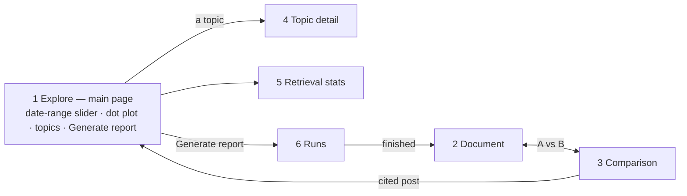

# 31 — Screens (DRAFT)

[← Index](../00-index.md) · [30 Frontend](../30-frontend.md) · [21 Topics](../20-data-model/21-topics.md) · [50 Prediction](../50-prediction.md) · [70 Comparison](../70-comparison.md) · [Open questions](../90-open-questions.md)

The app's screens, written as a design brief: the section below the line can be pasted
into Claude Design as-is to produce mockups. The document's content follows the brief
(OPEN-16, resolved); layout and styling are *proposed*. Sample content is illustrative,
not real data.

**Specified by Brian:** the main page is governed by a **date-range slider**. Moving it
populates and depopulates the dot plot, and a **Generate report** button produces the
Community Voices Document for the selected range. Each topic's engagement over time is
graphed (OPEN-17, resolved). Everything else is *proposed*.

---

## Design brief for Claude Design

**Product.** *Community Voices* — a web app that writes a weekly report on what an
online community talked about and predicts what it will talk about next week. The
community is **r/sailing** on Reddit. The report is written by an AI agent that
searches a database of the community's posts. The app also shows the same report
written by the AI **without** access to that database, side by side, with
measurements — that comparison is the centerpiece.

**Audience.** An engineering team watching a live demo on a laptop screen. It must read
clearly at 1440×900 and still work at phone width.

**Style.** Calm, editorial, data-dense but uncluttered — a cross between a good
newsletter and an analytics dashboard. A restrained nautical palette: deep navy ink,
off-white paper, one teal accent for "with retrieval" (version B), one warm sand/amber
for "without retrieval" (version A), and a coral used only for warnings (invented
topics). Serif for the report's headings and body text; a clean sans-serif for UI,
numbers and labels. Light and dark themes. No stock photos, no sailing clip-art.

**Global layout.** A slim top bar with the app name, navigation (Explore, Runs,
Retrieval stats), a theme toggle, and a status pill showing data freshness ("Data
through 17 Oct · 8 weeks · 21,480 posts"). The date range chosen on Explore carries
through to every other screen.

### Screen 1 — Explore (the main page)

Everything on this page is governed by one control.

- **Date-range slider** across the full width at the top, spanning the 8 weeks of
  history, with two handles and a small histogram of daily post volume behind it (so
  busy days are visible). Presets: "Last 7 days", "Last 14 days", "All 8 weeks". The
  chosen range is shown in words: "5 Oct – 11 Oct 2026 · 2,614 posts".
- **The dot plot** fills the center: a large 2D scatter of every post in the range,
  each dot one post, colored by topic. The map is recomputed for each range (OPEN-20):
  when the slider is released, dots for posts leaving the range **fade out**, new ones
  **fade in**, and the dots that stay **glide** to their new places, so the reshaping is
  visible rather than a jump. A faint "Recomputing map…" note shows while it runs. Hovering a dot shows a card (username, date, excerpt, topic);
  clicking it opens the post. Caption: "Each dot is a post. Posts close together mean
  similar things."
- **Topics panel** on the right: the topics active in the range, each row with its
  color swatch, name, a sparkline of daily engagement across the range, post count, and
  a badge (Rising / Steady / Fading / New). Hovering a row highlights its dots on the
  plot and dims the rest; clicking opens Topic detail.
- **Generate report** — the primary button, bottom-right of the plot, labeled with the
  range: "Generate report for 5–11 Oct". It starts a comparison run (both versions,
  with and without retrieval) and opens a progress panel in place, fed by live
  server-sent events: two lanes, A and B, each showing steps, tool calls with their
  results, and version B's text appearing as it's written; for example
  "Version A writing… done (9s)", "Version B: search('winterizing') → 15 posts",
  "Measuring…", with a progress bar. When done it offers "Read the report" and "See the
  comparison". If a report already exists for exactly this range, the button reads
  "Open report for 5–11 Oct" with a secondary "Generate again".
- **Highlight retrieved posts** toggle (shown once a report exists for the range):
  outlines the dots version B actually retrieved.

### Screen 2 — Document

The Community Voices Document for the range it was generated for, as a readable long
page (max width ~760px, centered).

- **Masthead:** "Community Voices — r/sailing", the range, and a subtitle line:
  "Written with retrieval · Claude · run #42 · Export as Markdown · See comparison".
- **The period in brief:** one paragraph summary.
- **What the community talked about:** 5–7 topic sections. Each has:
  - the topic name and a one-line description;
  - a small engagement sparkline for the 8 weeks with the report's range highlighted,
    and a badge: Rising / Steady / Fading / New;
  - two or three paragraphs of the report;
  - "Notable threads": 2–3 thread titles as links, each with comment count;
  - one or two pull-quotes from real posts, with username and date, e.g.
    *"Third time this season the impeller's gone. Carrying two spares now." — u/saltyketch,
    8 Oct*. Every quote and cited fact has a small superscript marker linking to the
    source post.
  - Example topics: "Winterizing and haul-out", "Impeller and raw-water cooling
    failures", "Hurricane season aftermath in the Caribbean", "First boat: what to buy
    under $20k", "Annapolis Sailboat Show", "Reefing technique in heavy weather".
- **What we expect next:** predictions for the period of the same length that follows
  the range. 4–6 prediction cards, each: topic name, badge, a small line chart of daily
  engagement plus a dashed projection band, and one sentence of evidence: *"Up from 3 to
  11 threads over three weeks; two debates still open on Sunday."* A card for a
  scheduled event: *"Annapolis Sailboat Show opens Thursday — mentioned in 14 posts."*
- **Footer note:** "Brand-new conversations can't be predicted; this forecast covers
  topics already in motion."

### Screen 3 — Comparison (the centerpiece)

Version A (without retrieval) and version B (with retrieval) of the same document,
side by side.

- **Scoreboard strip** across the top, A vs B, each metric as two numbers with a small
  bar: Main topics found (A 2 of 10 / B 8 of 10), Topics invented (A 5 / B 0), Order of
  importance (A poor / B close), Direction right (A 1 of 2 / B 7 of 8), Prediction
  score (A 22% / B 71%), Tokens and time (A 2.1k · 9s / B 48k · 64s).
- **Two columns** of the document, A labeled "Without our data — the model on its own"
  in amber, B labeled "With retrieval — the model searching r/sailing's posts" in teal.
  Version A should read plausible but generic ("Sailors discussed maintenance and
  safety as the season winds down").
- **Topic grid** below — the answer key against both reports: rows are the range's real
  topics ranked by engagement, with each one's measured direction; for A and B, whether
  the report named it, what rank it gave it, and what direction it said. Extra rows at
  the bottom, in coral, for topics a report named that the community didn't discuss.
- **"What version B looked at"** drawer: the agent's tool calls in order — e.g.
  `search("impeller failure")` → 12 posts; `lookup(post 88213)`; `topic_trends()` —
  each expandable. A "Show on the dot plot" link returns to Explore with those posts
  outlined.
- Run metadata: model, settings, date run, "identical prompt except for tools".

### Screen 4 — Topic detail

Opened from the topics panel or a document section.

- Name, description, keywords as chips, first-seen date, badge.
- **The main chart:** daily engagement across the 8 weeks as stacked areas — posts,
  comments, upvotes (agreeing replies like "+1") — with distinct people as a line, the Explore
  range shaded, and the projection for the next period as a dashed band.
- "Typical posts": 3 post cards (username, date, excerpt, link).
- "How this topic was built": a compact timeline of tagging decisions —
  "12 Aug · minted from a cluster of 9 posts — reason: new conversation about…",
  "15 Aug · 6 posts attached".

### Screen 5 — Retrieval stats

- A sortable table: rank, post excerpt, author, topic, times retrieved, last retrieved,
  retrieved by (report agent / tagging agent).
- Filters: agent (default: report agent), run, date range.
- A small bar chart above: retrievals per topic.

### Screen 6 — Runs

- A list of every report run: range, date run, model, status, and the headline scores
  (main topics found by A and by B). Runs in progress show their live step.
- The committed example run is marked "Example — included with the repo".
- Each row opens its Document or Comparison.

## Open in this draft

- `?` Everything in the design brief is a proposal until Brian reviews the mockups.
