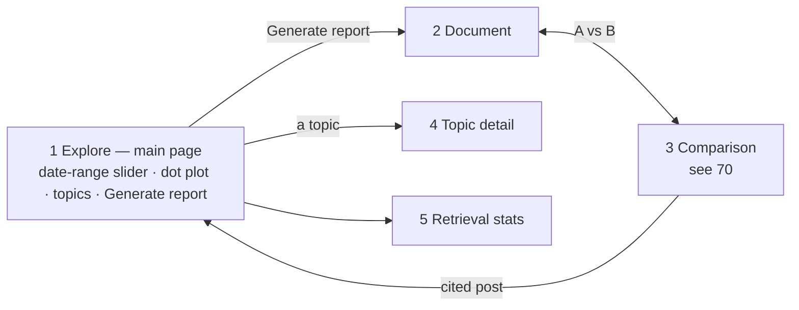

# 31 — Screens (DRAFT)

[← Index](../00-index.md) · [30 Frontend](../30-frontend.md) · [21 Topics](../20-data-model/21-topics.md) · [50 Prediction](../50-prediction.md) · [70 Comparison](../70-comparison.md) · [Open questions](../90-open-questions.md)

The app's screens, written as a design brief: the section below the line can be pasted
into Claude Design as-is to produce mockups. The document's content follows the brief
(OPEN-16, resolved); layout and styling are *proposed*. Sample content is illustrative,
not real data.

**Specified by Brian:** the main page is governed by a **date-range slider**. Moving it
populates and depopulates the dot plot, and a **Generate report** button produces the
Community Voices Document for the selected range. Each topic's engagement over time is
graphed (OPEN-17, resolved). Everything else is *proposed*.

---

## Design brief for Claude Design

**Product.** *Community Voices* — a web app that writes a weekly report on what an
online community talked about and predicts what it will talk about next week. The
community is **r/sailing** on Reddit. The report is written by an AI agent that
searches a database of the community's posts. The app also shows the same report
written by the AI **without** access to that database, side by side, with
measurements — that comparison is the centerpiece.

**Audience.** An engineering team watching a live demo on a laptop screen. It must read
clearly at 1440×900 and still work at phone width.

**Style.** Calm, editorial, data-dense but uncluttered — a cross between a good
newsletter and an analytics dashboard. A restrained nautical palette: deep navy ink,
off-white paper, one teal accent for "with retrieval" (version B), one warm sand/amber
for "without retrieval" (version A), and a coral used only for warnings (invented
topics). Serif for the report's headings and body text; a clean sans-serif for UI,
numbers and labels. Light and dark themes. No stock photos, no sailing clip-art.

**Global layout.** A slim top bar with the app name, navigation (Explore,
Retrieval stats), a theme toggle, and a status line showing the history's loading ("History
up to date through 17 Oct · 12,682 posts") and whether the backend is running. The date range chosen on Explore carries
through to every other screen.

### Screen 1 — Explore (the main page)

Everything on this page is governed by one control.

- **Date-range slider** across the full width at the top, spanning the 8 weeks of
  history, with two handles and a small histogram of daily post volume behind it (so
  busy days are visible). It opens on the **last 7 days** (OPEN-26). Presets: "Last 7 days", "Last 14 days",
  "All 8 weeks". The
  chosen range is shown in words: "5 Oct – 11 Oct 2026 · 2,614 posts".
- **The dot plot** fills the center: a large 2D scatter of every post in the range,
  each dot one post, colored by topic. The map is recomputed for each range (OPEN-20):
  when the slider is released, dots for posts leaving the range **fade out**, new ones
  **fade in**, and the dots that stay **glide** to their new places, so the reshaping is
  visible rather than a jump. A faint "Recomputing map…" note shows while it runs. Hovering a dot shows a card (username, date, excerpt, topic);
  clicking it opens the post. Caption: "Each dot is a post. Posts close together mean
  similar things."
- **Topics panel** on the right: the topics active in the range, each row with its
  color swatch, name, a sparkline of daily engagement across the range, post count, and
  a badge (Rising / Steady / Fading / New). Hovering a row highlights its dots on the
  plot and dims the rest; clicking opens Topic detail.
- **Generate report** — the primary button, bottom-right of the plot, labeled with the
  range: "Generate report for 5–11 Oct". It starts a comparison run (both versions,
  with and without retrieval) and opens a progress panel in place, fed by live
  server-sent events: two lanes, A and B, each showing steps, tool calls with their
  results, and version B's text appearing as it's written; for example
  "Version A writing… done (9s)", "Version B: search('winterizing') → 15 posts",
  "Measuring…", with a progress bar. When done it offers "Read the report" and "See the
  comparison". Reports aren't kept: generating again makes a new one.
- **Highlight retrieved posts** toggle (shown once a report exists for the range):
  outlines the dots version B actually retrieved.

### Screen 2 — Document

The Community Voices Document for the range it was generated for, as a readable long
page (max width ~760px, centered).

- **Masthead:** "Community Voices — r/sailing", the range, and a subtitle line:
  "Written with retrieval · Claude · See comparison", and a Download button *(maybe —
  reports are ephemeral; downloading is the only way to keep one)*.
- **The period in brief:** one paragraph summary.
- **What the community talked about:** 5–7 topic sections. Each has:
  - the topic name and a one-line description;
  - a small engagement sparkline for the 8 weeks with the report's range highlighted,
    and a badge: Rising / Steady / Fading / New;
  - two or three paragraphs of the report;
  - "Notable threads": 2–3 thread titles as links, each with comment count;
  - one or two pull-quotes from real posts, with username and date, e.g.
    *"Third time this season the impeller's gone. Carrying two spares now." — u/saltyketch,
    8 Oct*. Every quote and cited fact has a small superscript marker linking to the
    source post.
  - Example topics: "Winterizing and haul-out", "Impeller and raw-water cooling
    failures", "Hurricane season aftermath in the Caribbean", "First boat: what to buy
    under $20k", "Annapolis Sailboat Show", "Reefing technique in heavy weather".
- **What we expect next:** predictions for the period of the same length that follows
  the range. 4–6 prediction cards, each: topic name, badge, a small line chart of daily
  engagement plus a dashed projection band, and one sentence of evidence: *"Up from 3 to
  11 threads over three weeks; two debates still open on Sunday."* A card for a
  scheduled event: *"Annapolis Sailboat Show opens Thursday — mentioned in 14 posts."*
- **Footer note:** "Brand-new conversations can't be predicted; this forecast covers
  topics already in motion."

### Screen 3 — Comparison (the centerpiece)

Version A (without retrieval) and version B (with retrieval) of the same document,
side by side.

- **Scoreboard strip** across the top, A vs B, each metric as two numbers with a small
  bar: Main topics found (A 2 of 10 / B 8 of 10), Topics invented (A 5 / B 0), Order of
  importance (A poor / B close), Direction right (A 1 of 2 / B 7 of 8), Prediction
  score (A 22% / B 71%), Tokens and time (A 2.1k · 9s / B 48k · 64s).
- **Two columns** of the document, A labeled "Without our data — the model on its own"
  in amber, B labeled "With retrieval — the model searching r/sailing's posts" in teal.
  Version A should read plausible but generic ("Sailors discussed maintenance and
  safety as the season winds down").
- **Topic grid** below — the answer key against both reports: rows are the range's real
  topics ranked by engagement, with each one's measured direction; for A and B, whether
  the report named it, what rank it gave it, and what direction it said. Extra rows at
  the bottom, in coral, for topics a report named that the community didn't discuss.
- **"What version B looked at"** drawer: the agent's tool calls in order — e.g.
  `search("impeller failure")` → 12 posts; `lookup(post 88213)`; `topic_trends()` —
  each expandable. A "Show on the dot plot" link returns to Explore with those posts
  outlined.
- Run metadata: model, settings, date run, "identical prompt except for tools".

### Screen 4 — Topic detail

Opened from the topics panel or a document section.

- Name, description, keywords as chips, first-seen date, badge.
- **The main chart:** daily engagement across the 8 weeks as stacked areas — posts,
  comments, upvotes (agreeing replies like "+1") — with distinct people as a line, the Explore
  range shaded, and the projection for the next period as a dashed band.
- "Typical posts": 3 post cards (username, date, excerpt, link).
- "How this topic was built": a compact timeline of tagging decisions —
  "12 Aug · minted from a cluster of 9 posts — reason: new conversation about…",
  "15 Aug · 6 posts attached".

### Screen 5 — Retrieval stats

- A sortable table: rank, post excerpt, author, topic, times retrieved, last retrieved,
  retrieved by (report agent / tagging agent).
- Filters: agent (default: report agent), run, date range.
- A small bar chart above: retrievals per topic.

## How Explore is built (build step 4) *(proposed)*

Screen 1 above is the target; these are the details it needs underneath, all proposed.
The Generate report button works from build step 5 (plate [06](../06-build-order.md)),
and the retrieved-posts toggle arrives with it, since it needs a report. *(As built, step 5
made the button work; the toggle is not built.)*

- **Three reads from the API** (generated into a typed client, OPEN-1):
  - `GET /api/days` — posts per day across the history: the slider's histogram and the
    range's post count.
  - `GET /api/topics?start=…&end=…` — the topics with engagement in the range: label,
    description, the range's posts and comments, one number a day for the sparkline, and
    the badge.
  - `GET /api/map?start=…&end=…` — every post and comment written in the range with its
    place on the map, its thread's topic, author, date, thread title and a short excerpt
    for the hover card. Posts of threads with no topic yet are shown grey.
- **A day's engagement** for the sparkline is its posts plus comments plus upvotes
  (agreeing replies), from `topic_daily_engagement` ([21](../20-data-model/21-topics.md)).
- **The badge** is the topic's **momentum within the range** (Brian, 2026-10-19, OPEN-40):
  **New** if the topic was first seen inside the range; otherwise the range's second half
  against its first half (the middle day of an odd range left out), **Rising** if up by
  more than a quarter, **Fading** if down by more than a quarter, **Steady** in between. A
  one-day range is compared with the day before. The sparkline also draws the days before
  the range, faint, for context. This is the measured direction only; the forecast's own
  labels come with prediction (plate [50](../50-prediction.md), step 5).
- **The map** is t-SNE (a standard way of squashing many dimensions to two that keeps
  near neighbours near), on cosine distance, started from the principal components and
  with a fixed seed, so the same range always gives the same picture. Measured on the
  real data: about 6 seconds for a week (1,100 posts), 26 seconds for all eight weeks
  (12,700). It is computed in the API, not the worker (see plate [40](../40-backend.md)),
  and kept in Redis by range and the latest loaded day, so a range is computed once until
  a new day arrives.
- **Gliding:** each new map is turned, flipped and scaled to best match the one before it
  on the posts both share, so staying dots move only as far as the map really changed;
  then leaving dots fade out, arriving dots fade in, staying dots glide.
- **Colours:** the twelve biggest topics in the range get their own colour; the rest
  share a muted one, and still highlight on hover.
- **Linking:** the range lives in the address (`?start=…&end=…`, TanStack Router), so a
  reviewer can share exactly what they see; hover highlighting is browser-only state
  (Zustand).
- **Clicking a dot** opens the post on Reddit; clicking a topic's name opens Topic detail
  (step 6, below).

## How the report screens are built (build step 5) *(as built)*

What step 5 built against screens 1 to 3 above, so the brief and the app can be compared.

- **Generate report** (screen 1) starts a run for the range (`POST /api/runs`) and puts the
  run's id in Explore's address (`&run=<id>`), so a reload keeps the progress panel (its
  lanes start empty again, but the run's state is still read); choosing a new range drops
  it. The panel below the plot has two lanes, "A · without retrieval" and "B · with
  retrieval", each listing its steps ("Writing the report…", "Predicting the range: done
  (41s)") and each tool call with how many posts it returned (A's reads, B's searches and
  lookups; OPEN-39), from the run's live
  events (plate [41](../40-backend/41-live-events.md)). Then "Scoring both versions…" with a spinner, and as soon as the result is saved
  **Read the report** and **See the comparison**. There is no progress bar, and no text
  appearing as it's written.
- **Document** (screen 2), `/runs/<id>/report`, version B unless `?version=A`: the masthead
  ("Community Voices — r/sailing", the range, "Written with retrieval" or "Written without
  retrieval", the model, and a link to the comparison), the document as the model wrote it in
  Markdown (the period in brief, then one section per topic with its quotes), and beside it
  its topics with rank and direction, what it expected for the range, and its reasoning.
  Not built: the download button, per-topic sparklines and badges, the prediction cards
  with charts, quote markers linking to source posts, and the footer note.
- **Comparison** (screen 3), `/runs/<id>/comparison`: a header with the range, the model and
  "identical instructions; version A reads a few posts, only version B searches"; the scoreboard as a table, A against
  B (main topics found, topics invented, order of importance as close, partly or poor with
  its number, directions right, prediction score, tokens and time, and posts looked at);
  the topic grid (the range's main topics with each one's measured direction and what A and
  B said, rank and direction, with invented topics in red rows below); then both documents
  in two columns, amber for A and teal for B, each linking to its own Document page. Not
  built: the bars on the scoreboard, the "What version B looked at" drawer, and "Show on
  the dot plot".
- A finished run is read from `GET /api/runs/<id>`, which keeps it for a day (plate
  [70](../70-comparison.md)); after that both screens say the run isn't available.

## How Topic detail and Retrieval stats are built (build step 6) *(proposed)*

Screens 4 and 5 above are the target; these are the details underneath, all proposed.
*(As built, step 6 built every point below as written.)*

- **Two more reads from the API:**
  - `GET /api/topics/{id}` — the topic's label, description, keywords, first and last day
    seen; its engagement on each day it had any, across the whole history (posts,
    comments, upvotes, distinct people); its three typical posts; and the tagging decisions
    that built it. 404 for a topic that doesn't exist.
  - `GET /api/retrievals?start=…&end=…&agent=…&run=…` — the most retrieved posts, each
    with its rank, author, topic, times retrieved and last retrieval; retrievals per topic;
    the runs there are to choose from; and the total.
- **Typical posts** are the three threads closest to the topic's centre (cosine distance
  to the average of its threads' encodings), each shown by its opening post, or by its
  title when the post isn't stored.
- **The timeline** lists the decisions that minted the topic or attached threads to it,
  oldest first, each with how many threads carry it now. A thread decided again on its
  third day carries the later decision, so an early decision can show no threads.
- **The badge** on Topic detail is the one Explore shows for the same range; a topic with
  nothing in the range reads "Quiet in these days".
- **The chart** spans every loaded day. The dashed projection band is not drawn: the
  projected trends exist since step 5 (plate [50](../50-prediction.md)), but the chart
  doesn't show them yet.
- **The date range on Retrieval stats** picks the posts *written* in those days, not the
  days they were retrieved, so a range means the same thing on every screen.
- **The table** holds the 100 most retrieved posts, sortable by any column (TanStack
  Table); **the bars** show the twelve most retrieved topics. Posts whose thread has no
  topic yet count together as "No topic yet".
- **The agent filter** opens on the report agent. Until a report has been generated only
  the tagging agent has retrieved anything, so both agents are always shown as buttons, and
  an empty report view says why and offers the tagging agent's counts in one click.
- **Every screen keeps the range**: the top bar's links, the topic links and the back link
  carry `?start=…&end=…` with them.

## Open in this draft

- `?` Everything in the design brief is a proposal until Brian reviews the mockups.
