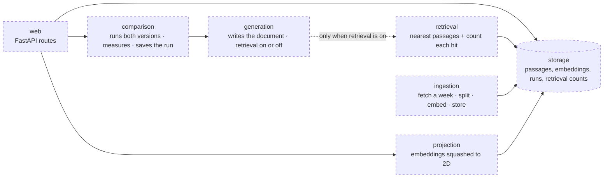

# 40 — Backend (DRAFT)

[← Index](00-index.md) · [01 System Map](01-system-map.md) · [30 Frontend](30-frontend.md) · [Open questions](90-open-questions.md)

The server side: the API the frontend calls, and the modules behind it that ingest,
store, retrieve, write and compare. Brian specified **FastAPI** and **Postgres**.
Everything else on this plate is *proposed*.

## Stack

| Concern | Choice |
|---|---|
| Web framework | **FastAPI** — specified. It publishes the OpenAPI description the frontend's client is generated from (OPEN-1, resolved) |
| Language | Python 3.12 *(proposed)* |
| Data shapes | Pydantic models, shared by the API and the modules *(proposed)* |
| Dependencies | uv, with a lockfile *(proposed)* |
| Tests | pytest, with stand-ins for the model, the embedder and the website (`CLAUDE.md` §7) *(proposed)* |
| Lint and format | Ruff for both *(proposed)* |
| Data store | **Postgres** — specified. How similarity search is done (the pgvector extension or otherwise) is on hold until the prediction approach is settled — OPEN-4 |
| Writing model | Claude, through Anthropic's API *(proposed, OPEN-5)* |
| Embedding model | A small open model run inside the container *(proposed, OPEN-5)* |
| Running it | Its own service in Docker Compose *(proposed)* |

## Modules *(proposed)*

`CLAUDE.md` §7 asks for these to be separate modules behind small interfaces. The
arrows are who calls whom.

- **generation** is one code path with a switch (`CLAUDE.md` §7): with retrieval off it
  never receives a retriever, so it cannot reach the store.
- **ingestion** runs as a command (`docker compose run …`), not inside the web server,
  and is never needed for the demo: a committed one-week snapshot is loaded instead.
- **projection** squashes embeddings to two dimensions for the embedding map, for
  example with UMAP, and caches the result per week.

## Open in this draft

- `?` Which community — OPEN-3. It decides what ingestion fetches.
- `?` How similarity search is done inside Postgres — OPEN-4, on hold until the prediction approach is discussed.
- `?` The writing model and the embedding model — OPEN-5.
- `?` Everything marked *proposed* above.
