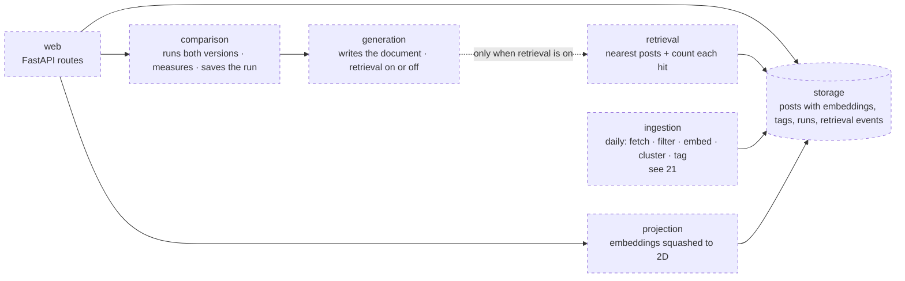
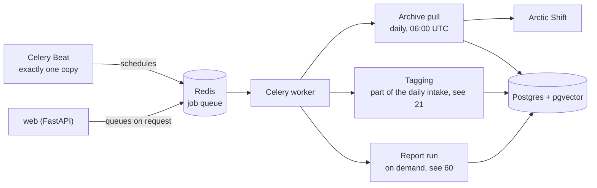

# 40 — Backend (DRAFT)

[← Index](00-index.md) · [01 System Map](01-system-map.md) · [30 Frontend](30-frontend.md) · [Open questions](90-open-questions.md)

The server side: the API the frontend calls, and the modules behind it that ingest,
store, retrieve, write and compare. Brian specified **FastAPI** and **Postgres**.
Everything else on this plate is *proposed*.

## Stack

| Concern | Choice |
|---|---|
| Web framework | **FastAPI** — specified. It publishes the OpenAPI description the frontend's client is generated from (OPEN-1, resolved) |
| Language | Python 3.12 *(proposed)* |
| Data shapes | Pydantic models, shared by the API and the modules *(proposed)* |
| Dependencies | uv, with a lockfile *(proposed)* |
| Tests | pytest, with stand-ins for the model, the embedder and the website (`CLAUDE.md` §7) *(proposed)* |
| Lint and format | Ruff for both *(proposed)* |
| Data store | **Postgres with pgvector** — specified (OPEN-4, resolved) |
| Writing and decision model | **Claude Sonnet 5.5, through OpenRouter** — specified (OPEN-5). One OpenRouter key, sent to reviewers in the submission email |
| Embedding model | **A small open model that takes long inputs (for example nomic-embed-text), run inside the container** — specified (OPEN-5); no key needed |
| Background jobs | **Celery** workers, with **Celery Beat** scheduling the archive pulls — specified. Broker: Redis, its own container *(proposed)* |
| Agents | **LangGraph / LangChain** — specified. Two agents, see [60](60-agents.md) |
| Running it | Its own service in Docker Compose *(proposed)* |

## Modules *(proposed)*

`CLAUDE.md` §7 asks for these to be separate modules behind small interfaces. The
arrows are who calls whom.

- **generation** is one code path with a switch (`CLAUDE.md` §7): with retrieval off it
  never receives a retriever, so it cannot reach the store.
- **ingestion** fetches posts **daily** from the **Arctic Shift** archive of Reddit (specified, OPEN-8), as a Celery task scheduled by Celery Beat (specified), behind a small *post source* interface so the source can be swapped for Reddit's official API by replacing one module *(interface proposed)*. It runs as a command (`docker compose run …`), not inside the web server,
  and is never needed for the demo: a committed one-week snapshot is loaded instead.
- **projection** (specified, OPEN-20): a post is embedded once, and its position on the
  dot plot is computed once, in the daily intake, and stored with it. The dot plot only
  ever reads stored positions. *(Proposed detail: the flattening (UMAP) is learned once
  from the full history, and each day's new posts are placed into that same layout.)*

## Background jobs *(proposed details)*

- **Only what's new** (Brian's call). Arctic Shift searches posts *and comments* by
  subreddit and creation time, so each pull asks for everything created since the
  newest item already stored — new comments on old threads included. Nothing already
  stored is fetched again. The start point is moved back an hour as a small overlap,
  because the archive can lag a little behind Reddit; the few repeats it brings are
  dropped on insert, since every post and comment is keyed by Reddit's own id
  (`CLAUDE.md` §7).
- **What that gives up: upvote counts.** A post's score keeps changing after it's
  fetched, and an only-what's-new pull never sees the change. So trends are built from
  counts that never change once something exists — posts, comments, distinct people,
  new threads — and score is stored but not used for trends.
- **Why daily is enough.** The document is weekly and trends are computed by the day;
  pulling more often adds load on a volunteer-run archive without changing any result.
- **Tagging and report runs are Celery jobs too.** A report run makes many LLM calls and
  can take a minute; the web request queues the job and returns at once, and the
  frontend checks its status through TanStack Query until it's done.
- **Beat runs as exactly one copy**, or every pull would happen twice.
- **The demo never waits on Beat.** The committed eight-week snapshot is loaded by a
  command; Beat only keeps the data fresh afterwards.

## Open in this draft

- `?` Everything marked *proposed* above.
