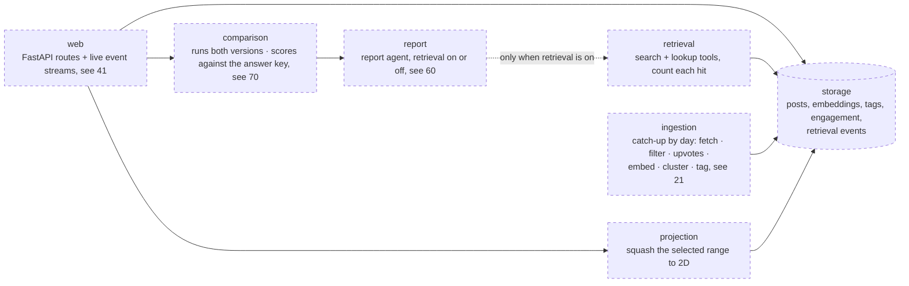
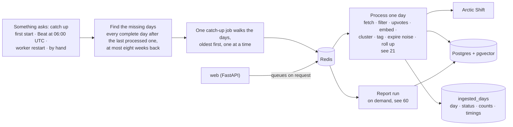

# 40 — Backend (DRAFT)

[← Index](00-index.md) · [01 System Map](01-system-map.md) · [30 Frontend](30-frontend.md) · [Open questions](90-open-questions.md)

The server side: the API the frontend calls, and the modules behind it that ingest,
store, retrieve, write and compare. Brian specified **FastAPI** and **Postgres**.
Everything else on this plate is *proposed*.

## Stack

| Concern | Choice |
|---|---|
| Web framework | **FastAPI** — specified. It publishes the OpenAPI description the frontend's client is generated from (OPEN-1, resolved) |
| Language | Python 3.12 *(proposed)* |
| Data shapes | Pydantic models, shared by the API and the modules *(proposed)* |
| Dependencies | uv, with a lockfile *(proposed)* |
| Tests | pytest, with stand-ins for the model, the embedder and the website (`CLAUDE.md` §7) *(proposed)* |
| Lint and format | Ruff for both *(proposed)* |
| Data store | **Postgres with pgvector** — specified (OPEN-4, resolved) |
| Tables and migrations | **Alembic** — specified (OPEN-28). Tables described once as SQLAlchemy models; migrations generated from them and applied by `setup` on every start |
| Writing and decision model | **Claude Sonnet 5.5, through OpenRouter** — specified (OPEN-5). One OpenRouter key, sent to reviewers in the submission email |
| Embedding model | **A small open model that takes long inputs (for example nomic-embed-text), run inside the container** — specified (OPEN-5); no key needed |
| Background jobs | **Celery** workers, with **Celery Beat** scheduling the archive pulls — specified. Broker: Redis, its own container *(proposed)* |
| Live updates | **Server-sent events**, detailed, from every agent and job — specified. See [41](40-backend/41-live-events.md) |
| Agents | **LangGraph / LangChain** — specified. Two agents, see [60](60-agents.md) |
| Running it | Its own service in Docker Compose *(proposed)* |

## Modules *(proposed)*

`CLAUDE.md` §7 asks for these to be separate modules behind small interfaces. The
arrows are who calls whom.

- **report** is one code path with a switch (`CLAUDE.md` §7): with retrieval off it
  never receives the retrieval tools, so it cannot reach the store.
- **ingestion** fetches posts **daily** from the **Arctic Shift** archive of Reddit (specified, OPEN-8), as a Celery task scheduled by Celery Beat (specified), behind a small *post source* interface so the source can be swapped for Reddit's official API by replacing one module *(interface proposed)*. It runs in the Celery worker, not inside the web server; first start and the daily
  pull are the same catch-up over a range of days (see *Background jobs*, OPEN-13).
- **projection** (specified, OPEN-20): a post is embedded once, at intake. The squashing
  to two dimensions is **recomputed from the posts in the selected date range** whenever
  the range changes, so the dot plot always shows the clearest map of that range.
  *(Proposed details: computed in the worker when the slider is released, not while it's
  dragged; a fixed random seed so the same range always gives the same picture; each
  result cached by range; progress and result sent over the live events
  ([41](40-backend/41-live-events.md)).)*

## Background jobs

**Specified by Brian:** there is **one ingestion operation: process a range of days,
through Celery**. First start, the daily pull, and waking up after downtime to find ten
days missing are all the same operation over different ranges. Details are
*proposed*.

- **The unit of work is one day.** A day job fetches every post and comment *created
  that day* (Arctic Shift searches both by subreddit and creation time), then runs the
  whole daily intake for it ([21](20-data-model/21-topics.md)). New comments on old
  threads come in with the day they were written. Nothing is fetched twice; a repeat is
  dropped on insert, since every item is keyed by Reddit's own id (`CLAUDE.md` §7).
- **Days run strictly in order, one at a time.** Tagging moves forward in time and the
  three-day lookahead needs the days before it done (OPEN-11). As built, one catch-up job
  walks the missing days in order, each day in its own transaction, and stops at the first
  failure; a day starts only when the one before has finished.
- **Only complete days.** A day is processed once it's over and the archive has had a
  few hours to catch up, so the 06:00 UTC run takes yesterday.
- **`ingested_days` is the record of what's done** — one row per day with its status,
  item counts and timings. "Catch up" just means "every complete day not marked done".
  A day that fails stays not-done, the chain stops there, and the next catch-up retries
  it. Progress is streamed live ([41](40-backend/41-live-events.md)); this table gives the
  measured prewarm time (OPEN-13).
- **Catch-up is safe to trigger twice.** A lock means a second request while a chain is
  running does nothing, so Beat, a restart and a click can't start parallel chains.
- **What only-new fetching gives up: upvote counts.** Reddit's score keeps changing
  after a post is fetched and is never re-fetched, so trends use counts that never
  change once something exists, and `reddit_score` is stored but not used for trends.
- **Why daily is enough.** Trends are counted by the day; pulling more often adds load
  on a volunteer-run archive without changing any result.
- **Report runs are Celery jobs too.** A report makes many LLM calls; the web request
  queues it and returns at once, and the frontend watches it through live events
  ([41](40-backend/41-live-events.md)).
- **Beat runs as exactly one copy.**

## Open in this draft

- `?` Everything marked *proposed* above.
