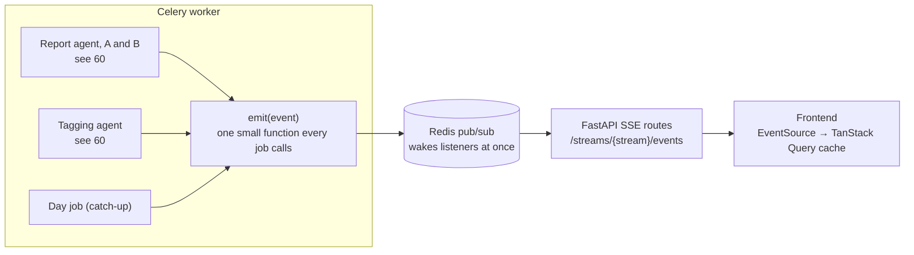

# 41 — Live events to the frontend (DRAFT)

[← Index](../00-index.md) · [40 Backend](../40-backend.md) · [60 Agents](../60-agents.md) · [31 Screens](../30-frontend/31-screens.md) · [Open questions](../90-open-questions.md)

How the frontend watches work happen. **Specified by Brian:** with several agents and
many tool calls, the backend sends **detailed server-sent events (SSE)** to the
frontend: a one-way stream from server to browser over an ordinary web request.
Everything else is *proposed*.

## Streams

| Stream | What it carries | Seen on |
|---|---|---|
| `run-{id}` | One comparison run: versions A and B side by side *(as built, the stream is named `run-` and the run's twelve-character id; first proposed as `runs/{id}`)* | Explore's progress panel *(as built, the Comparison screen reads the finished run instead of listening)* |
| `ingestion` | Catch-up: which day, how many posts, which step, tagging decisions | First-start progress, status pill |

## Events

Every event has: a number (in order within its stream), a time, a type, which version
(`A` or `B`) or which day it belongs to, and a small JSON body. *(As built: a type, a time,
the version or day, and the body; there is no running number.)*

| Type | When | Body, in short |
|---|---|---|
| `run.started` / `run.finished` / `run.failed` | A run begins, ends, or stops on an error | range, model, totals; the error in plain words *(as built: `run.started` carries the range and the model, `run.finished` nothing, since the totals are in the run's result)* |
| `step.started` / `step.finished` | A LangGraph step is entered or left | step name, duration *(as built: a version starts or finishes one of its two steps, writing the report or predicting the range; the step's name, and on finishing its seconds and tool calls)* |
| `llm.token` | The report agent writes, a few words at a time | the text so far is rebuilt by the frontend, so the document visibly writes itself *(not built: each document arrives whole when its version finishes)* |
| `tool.called` | An agent calls a tool | tool name and arguments: `search("heavy weather")`, `lookup(88213)` *(as built, with the step's name)* |
| `tool.returned` | The tool answers | how many posts, their ids and excerpts, how long it took *(as built: the step's name, the tool, how many posts and their ids; no excerpts or timing)* |
| `decision.made` | The tagging agent decides on a cluster, sent the moment it does | attach / mint / noise, the tag, the reason |
| `mint.merged` | After a day's decisions, when two groups minted the same new topic | the group and the group it joins |
| `measurement.done` | A comparison measurement is computed | name and both scores |
| `catch_up.started` / `catch_up.finished` | A catch-up begins or ends | how many days it covers |
| `day.started` / `day.finished` / `day.failed` | Catch-up progress | day, progress ("4 of 56"), the day's counts or the error |
| `day.step` | Each step within a day begins | day, step: `fetching`, `embedding` (with `posts`), `grouping` (with `threads`), `tagging` (with `groups`; the `decision.made` events count them off), `applying`. The top bar's loading line ends with the step: "Loading 18 Oct · tagging: 3 of 7 groups decided" |
| `backfill.progress` | The first boot rebuilds the seed's vectors ([07](../07-boot-data.md)) | what is being prepared (posts, threads, topics), how many done of how many |
| `map.ready` | The dot plot's squashing for a newly selected range is done | the range, each post's position |
| `usage` | After each model call | tokens in and out, running cost *(as built: tokens in and out once per step; no cost)* |

## How it works

- **One place emits.** Every job calls one small `emit` function; nothing else in the
  backend knows how events travel. Agents emit through LangGraph's event stream and
  LangChain callbacks, wrapped by our own code (`CLAUDE.md` §8), so the agents don't
  know about SSE. *(As built, the jobs call `emit` directly: the tagging step announces each decision, and
  the comparison run hands each version an `emit` already bound to its stream and version.
  Both agents run as LangGraph fan-outs, but they announce through `emit`, not through
  LangGraph's event stream or LangChain callbacks.)*
- **Live only.** `emit` publishes on Redis and the SSE route passes it on. Events are
  not stored: runs aren't referred back to (OPEN-24). *(As built, a run's result, not its
  events, is kept in Redis for a day so the Document and Comparison screens can show it.)*
- **Frontend.** One small hook opens an `EventSource` per stream and folds events into
  the TanStack Query cache, so screens just read data and re-render; Zustand isn't
  needed for this. *(As built, one hook, `useLiveEvents`, opens the stream and hands each
  event to the screen: the loading line and Explore refetch their data on `ingestion`
  events, and the progress panel folds a run's events into its own two lanes, rereading
  the run's state every three seconds while it runs in case one was missed.)*
- **Tokens are batched.** `llm.token` events are grouped (for example every 100
  milliseconds) so the stream stays light. *(Not built, since `llm.token` isn't.)*
- **A heartbeat** comment every 15 seconds keeps idle connections open through
  proxies.
- **Tests** subscribe to a run in memory and assert the exact sequence of events a
  stand-in agent produces. *(As built, the comparison run's test collects the events a
  stand-in model produces and checks that they open with `run.started`, close with
  `run.finished`, include the measurements, and that only version B calls tools; not the
  exact sequence.)*

## Open in this draft

- `?` Whether `llm.token` streaming is worth it for the demo (it makes the report
  visibly write itself, at the cost of more moving parts) — proposed yes, for the
  report agent only. Build step 5 shipped without it: each document arrives whole.
