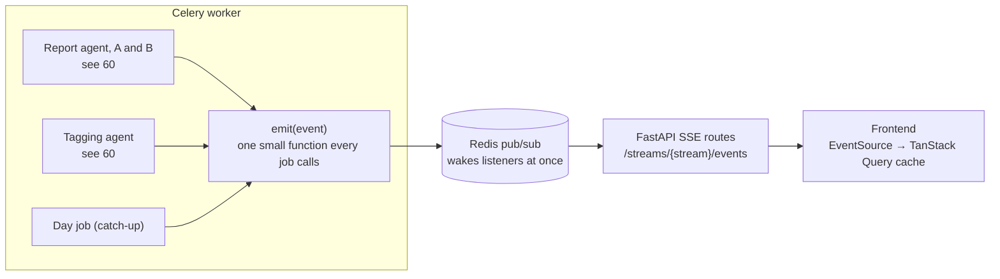

# 41 — Live events to the frontend (DRAFT)

[← Index](../00-index.md) · [40 Backend](../40-backend.md) · [60 Agents](../60-agents.md) · [31 Screens](../30-frontend/31-screens.md) · [Open questions](../90-open-questions.md)

How the frontend watches work happen. **Specified by Brian:** with several agents and
many tool calls, the backend sends **detailed server-sent events (SSE)** to the
frontend: a one-way stream from server to browser over an ordinary web request.
Everything else is *proposed*.

## Streams

| Stream | What it carries | Seen on |
|---|---|---|
| `runs/{id}` | One report run: versions A and B side by side | Explore's progress panel, Comparison |
| `ingestion` | Catch-up: which day, how many posts, which step, tagging decisions | First-start progress, status pill |

## Events

Every event has: a number (in order within its stream), a time, a type, which version
(`A` or `B`) or which day it belongs to, and a small JSON body.

| Type | When | Body, in short |
|---|---|---|
| `run.started` / `run.finished` / `run.failed` | A run begins, ends, or stops on an error | range, model, totals; the error in plain words |
| `step.started` / `step.finished` | A LangGraph step is entered or left | step name, duration |
| `llm.token` | The report agent writes, a few words at a time | the text so far is rebuilt by the frontend, so the document visibly writes itself |
| `tool.called` | An agent calls a tool | tool name and arguments: `search("heavy weather")`, `lookup(88213)` |
| `tool.returned` | The tool answers | how many posts, their ids and excerpts, how long it took |
| `decision.made` | The tagging agent decides on a cluster | attach / mint / noise, the tag, the reason |
| `measurement.done` | A comparison measurement is computed | name and both scores |
| `catch_up.started` / `catch_up.finished` | A catch-up begins or ends | how many days it covers |
| `day.started` / `day.finished` / `day.failed` | Catch-up progress | day, progress ("4 of 56"), the day's counts or the error *(`day.step` events within a day: not built)* |
| `map.ready` | The dot plot's squashing for a newly selected range is done | the range, each post's position |
| `usage` | After each model call | tokens in and out, running cost |

## How it works

- **One place emits.** Every job calls one small `emit` function; nothing else in the
  backend knows how events travel. Agents emit through LangGraph's event stream and
  LangChain callbacks, wrapped by our own code (`CLAUDE.md` §8), so the agents don't
  know about SSE.
- **Live only.** `emit` publishes on Redis and the SSE route passes it on. Events are
  not stored: runs aren't referred back to (OPEN-24).
- **Frontend.** One small hook opens an `EventSource` per stream and folds events into
  the TanStack Query cache, so screens just read data and re-render; Zustand isn't
  needed for this.
- **Tokens are batched.** `llm.token` events are grouped (for example every 100
  milliseconds) so the stream stays light.
- **A heartbeat** comment every 15 seconds keeps idle connections open through
  proxies.
- **Tests** subscribe to a run in memory and assert the exact sequence of events a
  stand-in agent produces.

## Open in this draft

- `?` Whether `llm.token` streaming is worth it for the demo (it makes the report
  visibly write itself, at the cost of more moving parts) — proposed yes, for the
  report agent only.
