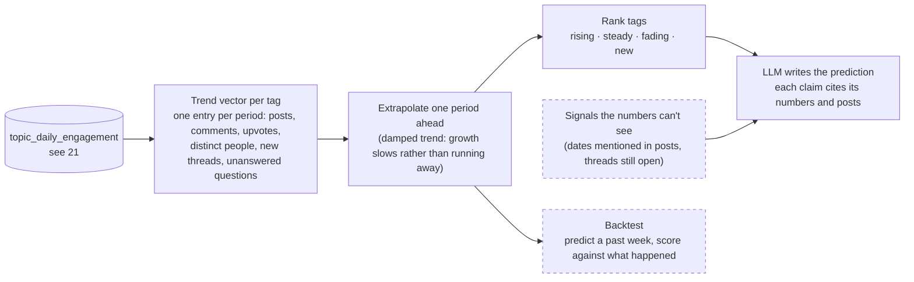

# 50 — Prediction (DRAFT)

[← Index](00-index.md) · [01 System Map](01-system-map.md) · [21 Topics](20-data-model/21-topics.md) · [Open questions](90-open-questions.md)

How the "next week" half of the Community Voices Document is produced.

**Specified by Brian:** posts are tagged day by day on intake (plate
[21](20-data-model/21-topics.md)), so any period is a range of days. Lining those
periods up gives each tag a **trend
vector**, and next week is predicted by **extrapolating** each tag's trend.
**Everything else is *proposed*.**

## The trend vector *(proposed)*

For each tag, one row per period with the period's engagement: posts, comments,
upvotes (agreeing replies),
distinct people, new threads, unanswered questions, all summed from plate 21's daily
table. A tag minted recently has a short vector. That's the "new" case, and the most
interesting one to call out.

## Extrapolating *(proposed)*

- **A damped trend, not a straight line.** With five to eight weeks of history a
  straight-line projection overreacts: one viral thread looks like a rocket. A damped
  trend (Holt's method with damping) follows the direction but expects it to level off,
  which is how online conversations usually behave.
- **On a log scale,** so a topic going from 2 to 4 posts and one going from 50 to 100
  read as the same growth.
- **The output per tag:** expected engagement next period, a range, and a label —
  rising, steady, fading, or new.

## What extrapolation can't see, and how it's covered *(proposed)*

- **A topic with no history** can't be extrapolated. New tags are flagged by their
  `first_seen` date and growth within the week.
- **Scheduled things:** a contest deadline or a software release mentioned in posts.
  These are pulled from the period's posts and handed to the LLM alongside the
  numbers.
- **Brand-new conversations next week** can't be predicted by any method. The
  document says so rather than inventing them.

## The written prediction *(proposed)*

The LLM receives the ranked tags with their trend numbers, the scheduled-event
signals, and the most typical posts for each tag. It writes the prediction, and
every claim names its evidence ("up from 3 to 11 threads over three weeks").
Version A of the comparison (`CLAUDE.md` §7) receives none of this, only the
community and the dates.

## Backtest *(proposed)*

The committed snapshot holds **eight weeks** (specified, OPEN-7): seven to fit, one to
score against.

Hold the most recent week back, predict it from the weeks before, and score both
versions against what the community actually discussed: which tags each version
expected to rise or appear, and which did. This puts a measured number on the
prediction half of the comparison.

## Open in this draft

- Nothing open on this plate.
