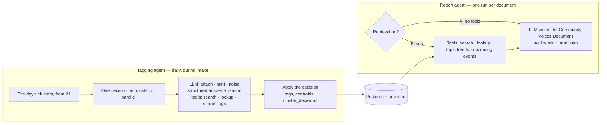

# 60 — Agents (DRAFT)

[← Index](00-index.md) · [01 System Map](01-system-map.md) · [21 Topics](20-data-model/21-topics.md) · [50 Prediction](50-prediction.md) · [Open questions](90-open-questions.md)

The LLM side of the app. **Specified by Brian:** a standard LangGraph / LangChain
flow with **two agents**: one that **ratifies the topic tags**, and one that
**generates the report**. Both agents have a **search** tool, to search posts for any
term when they want to hone in on a concept, and a **lookup** tool, to read one post by
its database id. Everything else on this plate is *proposed*.

## Shared tools: search and lookup

Specified by Brian; the details are *proposed*.

- **search(term)** — **semantic** (specified): the term is embedded and pgvector finds
  the posts and comments closest to it in meaning, so "heavy weather" also finds posts
  about reefing in a gale that never use those words. Limited to the period being worked on
  unless the agent asks wider; returns at most 20 hits, each with its post id, author,
  date, thread title, an excerpt, and how close it was *(proposed)*.
- **lookup(id)** — returns one post or comment in full: its text, author, date, thread
  title, and the id of what it replies to, so the agent can climb a conversation one
  lookup at a time.
- Every post either tool returns is counted in the retrieval statistics.
- Both tools are read-only, and run through the same small query module the rest of
  the backend uses.

## Tagging agent *(proposed details)*

**Specified by Brian (2026-10-18):** the tagging agent runs on **Claude Haiku 5.5** through
OpenRouter, and gets **at most three look-ups** before it must decide. Both are for cost.

- **One graph run per day, during intake.** Clustering happens first in plain code
  (plate [21](20-data-model/21-topics.md)); the graph then sends every cluster to its
  own decision step, all in parallel (LangGraph's fan-out).
- **Each decision is one LLM call with a structured answer:** attach (which tag),
  mint (label + description) or noise, plus a reason. It's shown the cluster's typical
  posts and the nearest tags with their descriptions and recent engagement.
- **Tools:** search and lookup (above), to read more of a cluster's conversation before
  deciding; and **search tags**, to search all tags by meaning when none of the nearest
  candidates fits, before minting a duplicate.
- **Order matters for minting.** Two clusters in the same run could both mint a tag for
  the same new conversation. Decisions that mint are re-checked against tags minted
  earlier in the same run before they're applied.

## Report agent *(proposed details)*

- **One graph, one switch** (`CLAUDE.md` §7). Version A runs with **no tools at all,
  including search and lookup**: they read our store, and version A is by definition
  the model without our store. The model knows only the community and the dates.
  Version B gets four tools:
  - **search** and **lookup** (above) — search is the retrieval: every hit is counted
    for the retrieval statistics;
  - **topic trends** — the ranked, extrapolated tags from plate [50](50-prediction.md);
  - **upcoming events** — posts mentioning dates after the period (regattas, boat
    shows, weather windows).
- **The tools are the retrieval.** Giving the agent tools rather than pasting posts
  into the prompt lets it look up what it needs as it writes, and its tool calls stream
  live, so the comparison can show exactly what version B looked at.
- **Same model, same settings, same prompt wording** for both versions; only the tools
  differ.

## Around the agents *(proposed)*

- **Everything the agents do is streamed live** to the frontend — steps, tool calls and
  results, decisions, the report as it's written, token use — as server-sent events
  (specified by Brian; see [41](40-backend/41-live-events.md)).

- **A cap on tool calls per run** (for example 30), so an agent that keeps searching
  ends with what it has instead of running up cost. The cap is saved with the run.

- **LangChain is wrapped behind our own small interfaces** (`CLAUDE.md` §8), so the rest
  of the code doesn't depend on it and tests can swap in LangChain's fake chat models
  and run offline.
- **The comparison's measurements are not a third agent.** Both reports are scored by
  code against the same answer key computed from the topic data ([70](70-comparison.md));
  the one judging prompt (matching a named topic to a tag) is fixed and identical for
  both versions.

## Open in this draft

- Nothing open on this plate.
