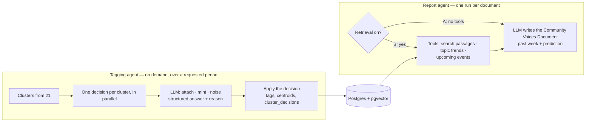

# 60 — Agents (DRAFT)

[← Index](00-index.md) · [01 System Map](01-system-map.md) · [21 Topics](20-data-model/21-topics.md) · [50 Prediction](50-prediction.md) · [Open questions](90-open-questions.md)

The LLM side of the app. **Specified by Brian:** a standard LangGraph / LangChain
flow with **two agents**: one that **ratifies the topic tags**, and one that
**generates the report**. Everything else on this plate is *proposed*.

## Tagging agent *(proposed details)*

- **One graph run per requested period.** Clustering happens first in plain code
  (plate [21](20-data-model/21-topics.md)); the graph then sends every cluster to its
  own decision step, all in parallel (LangGraph's fan-out).
- **Each decision is one LLM call with a structured answer:** attach (which tag),
  mint (label + description) or noise, plus a reason. It's shown the cluster's typical
  posts and the nearest tags with their descriptions and recent engagement.
- **One tool, for when none of the candidates fit:** search all tags by meaning, so the
  agent can look further before minting a duplicate.
- **Order matters for minting.** Two clusters in the same run could both mint a tag for
  the same new conversation. Decisions that mint are re-checked against tags minted
  earlier in the same run before they're applied.

## Report agent *(proposed details)*

- **One graph, one switch** (`CLAUDE.md` §7). Version A runs with no tools: the model
  knows only the community and the dates. Version B gets three tools:
  - **search passages** — pgvector similarity search over the requested period; every
    hit is counted for the retrieval statistics;
  - **topic trends** — the ranked, extrapolated tags from plate [50](50-prediction.md);
  - **upcoming events** — passages mentioning dates after the period (regattas, boat
    shows, weather windows).
- **The tools are the retrieval.** Giving the agent tools rather than pasting passages
  into the prompt lets it look up what it needs as it writes, and the tool calls are
  saved, so the comparison can show exactly what version B looked at.
- **Same model, same settings, same prompt wording** for both versions; only the tools
  differ.

## Around the agents *(proposed)*

- **Runs are saved** with LangGraph's Postgres checkpointer, in the same database: every
  step, prompt, tool call and output, which is what the comparison screen replays.
- **LangChain is wrapped behind our own small interfaces** (`CLAUDE.md` §8), so the rest
  of the code doesn't depend on it and tests can swap in LangChain's fake chat models
  and run offline.
- **The comparison's measurements are not a third agent.** Counting claims traceable to
  real posts is code; where a judging LLM call is needed it's a single fixed prompt,
  saved with the result and identical for both versions.

## Open in this draft

- `?` The models — OPEN-5.
