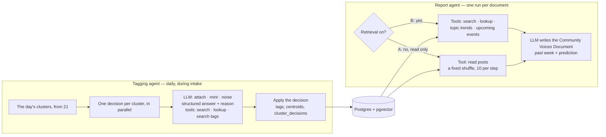

# 60 — Agents (DRAFT)

[← Index](00-index.md) · [01 System Map](01-system-map.md) · [21 Topics](20-data-model/21-topics.md) · [50 Prediction](50-prediction.md) · [Open questions](90-open-questions.md)

The LLM side of the app. **Specified by Brian:** a standard LangGraph / LangChain
flow with **two agents**: one that **ratifies the topic tags**, and one that
**generates the report**. Both agents have a **search** tool, to search posts for any
term when they want to hone in on a concept, and a **lookup** tool, to read one post by
its database id. Everything else on this plate is *proposed*.

## Shared tools: search and lookup

Specified by Brian; the details are *proposed*.

- **search(term)** — **semantic** (specified): the term is embedded and pgvector finds
  the posts and comments closest to it in meaning, so "heavy weather" also finds posts
  about reefing in a gale that never use those words. Limited to the period being worked on
  unless the agent asks wider; returns at most 20 hits, each with its post id, author,
  date, thread title, an excerpt, and how close it was *(proposed)*.
- **lookup(id)** — returns one post or comment in full: its text, author, date, thread
  title, and the id of what it replies to, so the agent can climb a conversation one
  lookup at a time.
- Every post either tool returns is counted in the retrieval statistics.
- Both tools are read-only, and run through the same small query module the rest of
  the backend uses.

## Tagging agent *(proposed details)*

**Specified by Brian (2026-10-18):** the tagging agent runs on **Claude Haiku 5.5** through
OpenRouter, and gets **at most three look-ups** before it must decide. Both are for cost.

- **One graph run per day, during intake.** Clustering happens first in plain code
  (plate [21](20-data-model/21-topics.md)); the graph then sends every cluster to its
  own decision step, all in parallel (LangGraph's fan-out).
- **Each decision is one LLM call with a structured answer:** attach (which tag),
  mint (label + description) or noise, plus a reason. It's shown the cluster's typical
  posts and the nearest tags with their descriptions and recent engagement.
- **Tools:** search and lookup (above), to read more of a cluster's conversation before
  deciding; and **search tags**, to search all tags by meaning when none of the nearest
  candidates fits, before minting a duplicate.
- **Order matters for minting.** Two clusters in the same run could both mint a tag for
  the same new conversation. Decisions that mint are re-checked against tags minted
  earlier in the same run before they're applied.

## Report agent *(proposed details)*

**Specified by Brian (2026-10-19, [OPEN-39](90-open-questions.md)):** version A reads
posts (a fixed shuffle, no retrieval by meaning), at most 35 per step, spread evenly over the days (raised from 10 the same day); version B searches by
meaning. Version A must have read access to posts, but no retrieval by meaning, and a budget
of 35 posts per step (first 10), spread evenly over the time, so it can't go round in a loop of turns. Also specified the same day: both
versions' report instructions are nudged a little toward prediction, asking, for each topic,
where it looks to be heading next and why; the rest of the instructions and the document's
structure stay as they were.

- **One graph, one switch** (`CLAUDE.md` §7). Version A gets **one tool, read posts**, and
  never search, lookup, topic trends or upcoming events: those are the retrieval, and
  version A is by definition the model without retrieval. *(Before 2026-10-19 version A had
  no tools at all, and with nothing concrete to go on it would not name anything specific.)*
  Version B gets four tools:
  - **search** and **lookup** (above) — search is the retrieval: every hit is counted
    for the retrieval statistics;
  - **topic trends** — the ranked, extrapolated tags from plate [50](50-prediction.md);
  - **upcoming events** — posts mentioning dates after the period (regattas, boat
    shows, weather windows).
- **The tools are the retrieval.** Giving the agent tools rather than pasting posts
  into the prompt lets it look up what it needs as it writes, and its tool calls stream
  live, so the comparison can show exactly what version B looked at.
- **read posts** (version A's one tool) — whole posts and comments from the period, a
  few at a time, in an order that has nothing to do with meaning, so version A sees real
  posts without being handed the relevant ones. Reads aren't retrieval, so they aren't
  counted in the retrieval statistics.
- **Same model, same settings, same prompt wording** for both versions; only the tools
  differ.

*As built (build step 5):*

- **A LangGraph graph.** The run is a LangGraph fan-out: one branch per version, both at
  once, each running that version's two steps, and the results are collected in the order
  A, B. Inside each branch a plain loop of our own over LangChain, `ReportWriter`, takes the
  step's model turns and tool calls; this is the tagging agent's design too, whose decision
  loop runs inside its own LangGraph fan-out. Each version is offered exactly its own tools
  and the answer: version A `read_posts`, version B the four tools. The model is Claude Sonnet 5.5 through OpenRouter (`REPORT_MODEL_NAME`).
- **Two steps per version:** first it writes the report for the range, then, as of the day
  before the range began, it predicts the range (plate [50](50-prediction.md), OPEN-22).
  Each step answers through its own answer tool, `Report` (the document in Markdown and its
  list of topics with rank and direction) or `Prediction` (the expected topics with
  directions, and two or three sentences of reasoning); these are the committed lists of
  OPEN-25. Both versions are told, in the same words, to write from what they can see in the
  community's posts with their tools and from what the model knows of the community and the
  season, and to say plainly where the evidence is thin; the report asks, for each topic,
  where it looks to be heading next and why.
- **What version A's tool sees:** the same days as version B's tools (the range while
  writing, the 28 days before it while predicting). **read_posts** takes an optional day
  inside those days and returns up to 5 whole posts written then, each with its author, date
  and thread title, in a shuffle fixed by the run (ordered by `md5(post id || run name)`, so
  the same run reads the same posts), never one it has already given. Each step may read 35
  posts in all; after that it answers "No posts left to read; answer now with what you
  have." Its calls stream live like version B's, so version A's lane shows its reads.
- **What version B's tools see:** while writing, only the range; while predicting, only the
  28 days before it, so the forecast can't peek inside the range. **search** returns at
  most 20 posts by meaning, always within those days (it never asks wider). **lookup**
  refuses a post written after them. **topic trends** gives the range's measured topics
  while writing, and the projected trends of plate [50](50-prediction.md) while predicting.
  **upcoming events** is a search by meaning for posts in those days that read like dated
  plans (regattas, races, boat shows, festivals, meetups), at most 15; it doesn't check
  that the dates fall after the period. Every post returned is counted in the retrieval
  statistics as the report agent's, under the run `report-<id>`.
- **A cap of 20 turns per step:** each tool call spends one, and so does a reply that calls
  no tool, so a model that keeps searching or keeps talking still stops. After that only
  the answer is offered (one reply asking for several tools can take it a little past 20),
  and a reply without a valid answer is told why, or reminded, once before the run fails.
  The cap is fixed in code and not saved with the run.

## Around the agents *(proposed)*

- **Everything the agents do is streamed live** to the frontend — steps, tool calls and
  results, decisions, the report as it's written, token use — as server-sent events
  (specified by Brian; see [41](40-backend/41-live-events.md)). *(As built, everything
  except the report as it's written: each document arrives whole.)*

- **A cap on tool calls per run** (for example 30), so an agent that keeps searching
  ends with what it has instead of running up cost. The cap is saved with the run.
  *(As built, for the report agent: 20 turns per step, fixed in code and not saved with the
  run; see above.)*

- **LangChain is wrapped behind our own small interfaces** (`CLAUDE.md` §8), so the rest
  of the code doesn't depend on it and tests can swap in LangChain's fake chat models
  and run offline.
- **The comparison's measurements are not a third agent.** Both reports are scored by
  code against the same answer key computed from the topic data ([70](70-comparison.md)).
  Matching a named topic to a tag is done by meaning in code, with no model call (built
  in step 5); if a judging prompt for borderline matches is added, it is fixed and
  identical for both versions.

## Choosing the tagging model: the bake-off

**Specified by Brian (2026-10-18):** tests that compare the models' performance on sample
data, committed into the repo, documented in the architecture docs and the README, and
benchmarked; then a bake-off between Claude Haiku 5.5 and Claude Sonnet 5.5.

*Proposed:*

- **Sample data:** a fixed set of about thirty tagging cases cut from real r/sailing threads, committed as a file of test data. Each case is one group of threads, a short list of existing topics written for the bake-off, and the right answer: attach to a named topic, start a new topic, or noise. The right answers are labelled by Claude from reading the threads, and marked as such until Brian reviews them.
- **The same decision code as production:** each case goes through the real tagging decision, with the same instructions, tools and look-up cap. The tools read the case file instead of the database; search uses the real embedding model, so it finds things by meaning as it does in production.
- **Measured for each model:** how many cases it got right; how often it picked the right topic when attaching; how often it started a duplicate topic when one existed; how often it called a real conversation noise (the costliest mistake, since noise is deleted); look-ups used; time per decision; words-pieces read and written; and cost at OpenRouter's listed price.
- **How it runs:** one command, kept apart from the normal tests because it calls the real model and costs money: the normal test suite never runs it. It writes a results page into the repo, with the date and models, so the numbers are committed alongside the code.
- **What makes it a test:** it fails if the model the app is set to use for tagging gets fewer than eight cases in ten right, so a later model change can't quietly make tagging worse. The scoring and the case reader have their own offline tests with stand-in models.
- **Cost of one bake-off:** about $1 for Sonnet and a few cents for Haiku *(estimate)*.

*Measured:*

- **First results (measured 2026-10-19, 25 cases, one run each):** Haiku got 21 right (84%), Sonnet 22 (88%). Haiku cost $0.011 for the run and Sonnet $0.17, fifteen times more; both took about 2.4 seconds a decision and looked something up in only one decision in five. Results page: `docs/benchmarks/tagging-models.md`.
- **Where they differed:** only one case: a group of scenic sailing photos, which Sonnet made a new topic and Haiku called noise. Noise is deleted, so that is the costlier kind of mistake.
- **Where both were marked wrong:** the same three cases, and in each the label may be what's wrong: a regatta-poster debate and an America's Cup keepsake both went to the racing topic, and a "finally bought a boat" post whose replies are about rigging went to sail handling. These labels are Claude's and want Brian's review.
- **What it means for cost:** about $0.0005 a decision on Haiku and $0.007 on Sonnet, so roughly $1 for an eight-week first start on Haiku, or $15 on Sonnet *(from these 25 decisions; real days may look things up more)*.
- **Found by the first run:** Claude Sonnet 5.5 refuses a forced tool choice, so the old last turn, which forced the decision, failed on Sonnet. The last turn now offers only the decision and asks for it; both models run the same code.

## Open in this draft

- `?` The floor the tagging model must reach (proposed: eight cases in ten right), and
  whether Brian reviews the cases' right answers before they're trusted; three of them
  (above) look like labelling mistakes rather than model mistakes.
