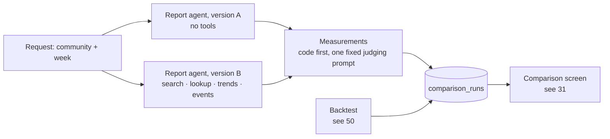

# 70 — Comparison: with and without retrieval (DRAFT)

[← Index](00-index.md) · [01 System Map](01-system-map.md) · [50 Prediction](50-prediction.md) · [60 Agents](60-agents.md) · [Open questions](90-open-questions.md)

The brief's step 5: how the model writes the Community Voices Document **without** our
store (version A) and **with** it (version B), compared inside the app. Brian asked for
this plate (OPEN-15); everything on it is *proposed*.

## What makes it a fair test

- **One code path, one switch** ([60](60-agents.md), `CLAUDE.md` §7). Same model, same
  settings, same prompt wording, same week, same output structure. The only difference
  is that version B has tools that read our store.
- **Both run from the same request,** in parallel, and are saved together.

## The measurements

| Measurement | What it shows | How it's computed |
|---|---|---|
| **Grounded claims** | How much of each document can be traced to a real post | The document is produced as structured output: a list of claims, each with the post ids it cites. Code checks every cited id exists in the week. Version A cites nothing it can check, so its claims are then matched against the week's posts by meaning (pgvector); a claim with no post above the closeness threshold is **unsupported** |
| **Unsupported claims** | Invented content | The claims left over from the row above |
| **Topic coverage** | Which of the week's real topics each version covered and missed | The week's tags ranked by engagement ([21](20-data-model/21-topics.md)); a topic counts as covered if a claim lands closest to that tag's centroid |
| **Specificity** | Concrete versus generic writing | Counts of named people (usernames), boats, places, dates and thread titles that appear in the week's posts; a generic sentence ("sailors discussed safety") scores nothing |
| **Prediction score** | Which version predicted better | The backtest ([50](50-prediction.md)): both versions predict a held-back week; scored by which tags they expected to rise or appear, against what happened |
| **Cost and time** | What retrieval costs | Tokens in and out, tool calls, seconds — from LangGraph's run record |

- **One judging prompt, only where code can't decide:** deciding whether a sentence is
  a *claim* at all. That prompt is fixed, saved with every run, and applied to both
  versions identically.

## comparison_runs

One row per comparison: the week, the snapshot it ran on, the model and settings, both
full prompts, both documents, version B's tool calls (and so the posts it retrieved),
every measurement, the judging prompt, and timings. The README links to one finished
run committed with the snapshot (OPEN-13), so reviewers see a result before running
anything.

## Open in this draft

- `?` The closeness threshold below which a claim counts as unsupported — tuned against
  the real data.
