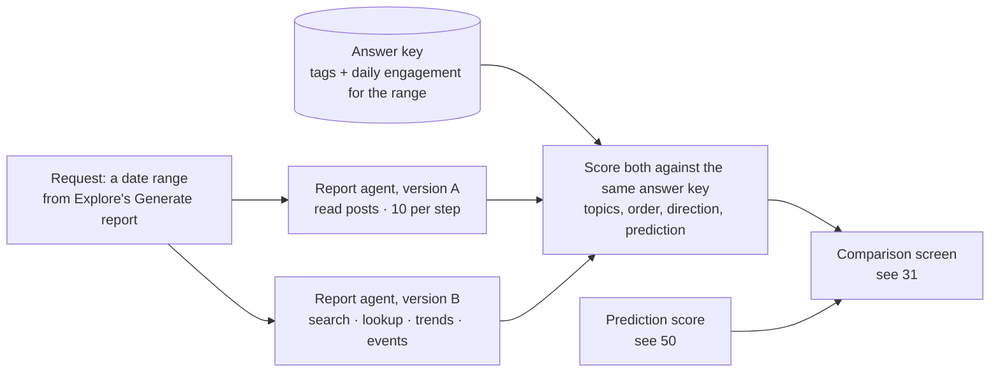

# 70 — Comparison: with and without retrieval (DRAFT)

[← Index](00-index.md) · [01 System Map](01-system-map.md) · [50 Prediction](50-prediction.md) · [60 Agents](60-agents.md) · [Open questions](90-open-questions.md)

The brief's step 5: how the model writes the Community Voices Document **without** our
store (version A) and **with** it (version B), compared inside the app. Brian asked for
this plate (OPEN-15); everything on it is *proposed*, except where it says what build
step 5 has already built (`backend/src/voices/comparison/`, see
`docs/architecture/comparison.md`).

## What makes it a fair test

- **One code path, one switch** ([60](60-agents.md), `CLAUDE.md` §7). Same model, same
  settings, same prompt wording, same date range, same output structure. The only difference
  is the tools. **Specified by Brian (2026-10-19, [OPEN-39](90-open-questions.md)):**
  version A reads posts (a fixed shuffle, no retrieval by meaning), at most 10 per step;
  version B searches by meaning. So version A sees some of the community's real posts, but
  not the ones that matter most to a topic, which only a search by meaning would find; the
  comparison measures what retrieval adds over reading a handful at random. Version A's reads
  see the same days as version B's tools, so its prediction can't look inside the range
  either, and they aren't counted in the retrieval statistics.
- **Both run from the same request,** in parallel.

## The measurements

**Specified by Brian:** the document's conclusions are **aggregate** — which topics
the community talked about, how much, and which way each was moving — drawn from the
topic and engagement data, not from individual posts. So the two versions are scored
on whether their aggregate conclusions match what the data shows, **not** on whether
each sentence traces to a post. Per-sentence checking is dropped (OPEN-21).

The answer key is computed by code from the topic tags and the daily engagement table
([21](20-data-model/21-topics.md)) for the date range: which topics were biggest, in
what order, which rose, which fell, which were new. Both versions are scored against
that same answer key. **Built in step 5:** the answer key is the Explore page's own topic
list for the range (the same engagement figures and the same new, rising, steady or
fading badges a reviewer sees there), ranked by engagement; topics with equal engagement
share a rank. The **main topics** are those ranked ten or better, so a tie at the cut
keeps every tied topic.

| Measurement | What it shows | How it's computed *(built in step 5)* |
|---|---|---|
| **Topics found** | Did the report name the range's real main topics? | Each topic the report names is matched to a tag by meaning (below); count how many distinct main topics it found |
| **Topics invented** | Topics the report names that the community didn't discuss in the range | Named topics that match no tag with any activity in the range. A name matching an active tag below the top ten is neither found nor invented |
| **Order of importance** | Did it rank the topics the way the data does? | Spearman's rank correlation (from 1, the same order, to -1, reversed) between the report's ranks and the answer key's ranks, over the topics it found; not measured with fewer than two |
| **Direction** | For each topic it names, did it say rising, steady or fading correctly? | Over the topics it found: how many directions match the answer key's badge |
| **Prediction** | Did the topics it said would be prominent next actually become prominent, moving the way it said? | Both versions commit to a list of expected topics and directions for the requested range, made using only what was known the day before the range began (OPEN-22, plate [50](50-prediction.md)). Counted: how many it named, how many became main topics, how many never came up, and how many became main topics moving the way it said; the prediction score is that last count divided by the number named |
| **Cost and time** | What retrieval costs | Tokens, tool calls, seconds *(built: tokens in and out, tool calls, seconds, and how many posts each version looked at; cost in money is not computed)* |

- **The report states its conclusions in a fixed form** alongside its prose: a list of
  topics, each with its rank and direction, plus the predicted ones (OPEN-25). That
  form is what gets scored, so scoring is code, not judgment.
- **Matching a named topic to a tag** is the one step that needs judgment ("winter
  prep" versus the tag "Winterizing and haul-out"). **Built in step 5,** it's done by
  meaning in code, with no model call: each name and each tag (its label and
  description) is turned into an embedding, and a name matches its most similar tag when
  the similarity is at least 0.80, set from the first real run, where right matches
  scored 0.83 to 0.91 and wrong ones 0.73 to 0.79. Each tag can be claimed by one name only; when two names point at
  the same tag, the closer one keeps it. The plan's fixed judging prompt for borderline
  matches is not built; if it is added, it is saved with the run and the same for both
  versions.

## No run history

Reports are ephemeral (Brian, OPEN-24): the two reports and their scores are shown when
the run finishes, and nothing keeps them. They may be made downloadable — that's the
only way a report outlives the page *(maybe, Brian)*.

*As built (build step 5):* a run's result is kept in Redis for one day, so the progress
panel's links to the Document and Comparison screens (`/runs/<id>/report`,
`/runs/<id>/comparison`) work after the run ends and survive a reload; after a day it is
gone. Its events are not kept, there is no list of past runs and no download. The posts
version B retrieved are counted in the retrieval statistics, like every retrieval.

## Open in this draft

- `?` How many of the range's top topics count as "main topics" for scoring — proposed
  the top ten by engagement, and built that way (one setting in code, with ties at the
  cut all kept) until Brian decides.
